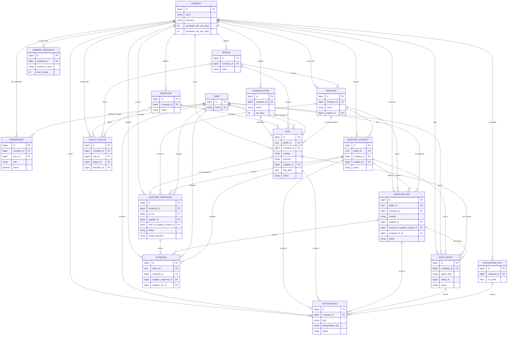

Status: APPROVED

# ncrflow data model

Scope: every table needed for build phases 1 to 6 in CLAUDE.md section 10. Phase 7 (PDF, dashboard, scorecard) and phase 8 (self-signup, billing) get no tables here; where a column exists only to make phase 7 possible it is called out in section 10.

This document is the source of truth. Code follows it, never the other way round.

Revision note (2026-11-13): the owner explicitly approved this document with `Status: APPROVED` and supplied the initial model-review outcome `PASS`. Current design: 17 tables, one role per company membership, global logins with multi-company memberships, and developer platform superuser. Q1-39 are accepted, as are Q41 (internal NCR read visibility per role) and Q42 (plain NCR audit history on the internal detail screen), both recorded after approval; Q25/Q34 retain deferred definitions and Q40 is superseded by Q2. The initial model PASS was owner-supplied. A later independent review of the implemented Phase 1 returned a clean PASS after corrections; see `phase-1-review.md` for scope and validation limits. Appendix B records the earlier screenshot follow-up.

## Conventions used in every table

| Convention | Decision | Reason |
|---|---|---|
| Primary key | `id`, `bigint`, generated by the database | It is the Django default already set in `settings.py` and is the cheapest join key. |
| Public identifier | `public_id`, `uuid`, unique, generated by the application (random, version 4) | Supplier-facing URLs must not expose guessable sequential ids (CLAUDE.md 5.2). |
| Tenant key | `company_id`, `bigint`, `NOT NULL`, on every business table except global user identity | Users reach company data through verified memberships. See section 2.2 for the global identity exception. |
| Timestamps | `timestamp with time zone`, stored in UTC; `created_at` and `updated_at` on every table except `audit_entry` (see that table) | One time standard in storage; display converts to `company.timezone`. |
| Dates | `date` columns hold a calendar day in the company's own timezone | A due date is a local business day, not an instant. |
| Status and choice columns | `varchar` holding a lowercase code, with a `CHECK` listing the allowed codes | A check constraint is easier to extend in a migration than a PostgreSQL enum type and is just as strict. |
| Optional text | `NOT NULL DEFAULT ''` rather than nullable | One representation of "empty" keeps queries and reports simple. |
| Deleting | No business row is ever deleted; every foreign key is `ON DELETE RESTRICT` (Django `PROTECT`) | A delete that would orphan history must fail loudly. Rows are retired with `active = false` or a status. |
| Same-company foreign key | Where a row points at another business row, the database also holds a composite foreign key `(company_id, x_id)` referencing `(company_id, id)` on the parent. Each parent therefore has `UNIQUE (company_id, id)`. | A row in company A can then never point at a row in company B, even if application code has a bug. Written "same company" in the constraint column below. |
| Same-company user | Where a row points at an internal user, the composite foreign key is `(company_id, x_user_id)` referencing `membership (company_id, user_id)` | The database then guarantees the user is a member of that company. |

The same-company foreign keys, the triggers in section 4.3 and the `NULLS NOT DISTINCT` unique constraint are plain PostgreSQL (version 17 is in `docker-compose.yml`). Django's ordinary single-column foreign keys stay as they are; the composite keys and triggers are added next to them in a migration as raw SQL. See approved decision 33.

Table names below are logical names. Django will create physical names prefixed with the app (for example `ncr_ncr`); the builder records the mapping when the models are written. Column names are the physical names.

---

## 1. Entity list

| # | Table | Suggested app | First needed in phase | What it stores and why it exists |
|---|---|---|---|---|
| 1 | `company` | tenants | 1 | One row per customer company (tenant), with its timezone and escalation thresholds. Everything else hangs off it. |
| 2 | `user` | accounts | 1 | Global email/password login; may have memberships in several companies (Q2 approved). The developer remains platform superuser. |
| 3 | `membership` | tenants | 1 | Links a user to a company with exactly one role in that company (Q1 approved). |
| 4 | `audit_entry` | tenants | 1 | Append-only log of every create, status change and review decision (CLAUDE.md 5.5). |
| 5 | `region` | tenants | 2 | Per-company list of regions, used on suppliers, NCRs and quality routes so that escalation routing matches exactly. |
| 6 | `discipline` | tenants | 2 | Per-company list of disciplines, used on NCRs and quality routes for the same reason. |
| 7 | `classification` | ncr | 2 | Per-company NCR classifications with SLA days, which drive the NCR due date. |
| 8 | `number_sequence` | tenants | 2 | One counter row per company per number series (NCR, SNCR), so numbers are issued without gaps or collisions. |
| 9 | `ncr` | ncr | 2 | The non-conformance report raised by the company, internal or against a supplier. |
| 10 | `supplier` | suppliers | 3 (table and screens; a company admin must be able to create suppliers before any external NCR is raised) | A supplier of one company. |
| 11 | `supplier_contact` | suppliers | 3 | A person at a supplier who receives magic links. Not a `user`: no password, not billed. |
| 12 | `supplier_response` | ncr | 3 | The supplier's single answer to one external NCR, including the review decision. |
| 13 | `evidence` | ncr | 3 | An uploaded file attached to a supplier response or (from phase 6) to an SNCR. |
| 14 | `notification` | notifications | 3 | One row per event and recipient, with delivery claims and retries. Event deduplication does not guarantee exactly one physical email. |
| 15 | `escalation_run` | escalation | 5 | One row per company per working day recording that the daily overdue task ran. |
| 16 | `quality_route` | escalation | 5 | Which quality users receive tier 2 escalations for which region and discipline. |
| 17 | `supplier_ncr` | sncr | 6 | An NCR raised by a supplier contact against the company (SNCR). |

Framework tables that Django creates itself (sessions, content types, permissions and groups, admin log, migration history) are not business tables and are not modelled here. The supplier's logged-in session lives in Django's session table and holds the `supplier_contact.id`.

Columns that point at a table from a later phase are added in that later phase: `ncr.supplier_id` in phase 3 (see the note on `ncr`), `audit_entry.ncr_id` in phase 2, `audit_entry.actor_supplier_contact_id` in phase 3, and `audit_entry.supplier_ncr_id`, `evidence.supplier_ncr_id` and `notification.supplier_ncr_id` in phase 6.

Nothing is designed for phase 7 or 8. **Later:** a stored scorecard or dashboard table, a "repeat of NCR" link, subscription and billing tables, and a self-signup table are all phase 7 or 8 and deliberately absent.

---

## 2. Table definitions

### 2.1 `company`

| Column | Type | Nullable | Default | Constraint | Note |
|---|---|---|---|---|---|
| id | bigint | no | generated | PK | |
| name | varchar(200) | no | | | Display name of the tenant. |
| timezone | varchar(64) | no | `'Africa/Johannesburg'` | must be a valid IANA zone name (checked in the form) | Used to show times and to decide when it is 07:00 and which local day it is. |
| escalation_tier_one_days | integer | no | 3 | CHECK >= 1 | Days overdue at which tier 1 escalation starts (CLAUDE.md 9.4: a company setting, not hardcoded). |
| escalation_tier_two_days | integer | no | 7 | CHECK > escalation_tier_one_days | Days overdue at which tier 2 escalation starts. |
| active | boolean | no | true | | A switched-off company is skipped by the daily task and its users cannot log in. |
| created_at | timestamptz | no | now | | |
| updated_at | timestamptz | no | now | | |

The "settings" in CLAUDE.md section 7 are explicit columns on this table, not a JSON blob, so they can be constrained and reported on.

### 2.2 `user`

| Column | Type | Nullable | Default | Constraint | Note |
|---|---|---|---|---|---|
| id | bigint | no | generated | PK | |
| email | varchar(254) | no | | UNIQUE; CHECK email = lower(email) | The login. Stored lowercase so `A@x.com` and `a@x.com` cannot both exist. |
| password | varchar(128) | no | | | Password hash, managed by Django. |
| full_name | varchar(200) | no | `''` | | Shown on screens and in emails. |
| is_active | boolean | no | true | | Switched off instead of deleting the user. |
| is_staff | boolean | no | false | | Django admin access for the developer; never granted through company registration or company-user management. |
| is_superuser | boolean | no | false | | Platform superuser is the owner/developer, not a customer role; never exposed in customer forms. |
| last_login | timestamptz | yes | null | | Maintained by Django. |
| created_at | timestamptz | no | now | | |
| updated_at | timestamptz | no | now | | |

Latest owner decision, 2026-11-13: the pasted defaults replace the earlier Q1/Q2 decisions. User is a global login identity with no company_id. Email is globally unique; separate memberships allow that login to belong to multiple companies. Company access always requires the current verified membership, never merely an authenticated global identity.

The developer remains the platform superuser. CHECK: is_staff = is_superuser, with both false for customers. The developer account is provisioned through trusted deployment administration, never registration or company-admin forms. Platform flags are not company roles. Multi-company support does not grant self-service joining of arbitrary companies; membership provisioning must be authorised for its company. Self-signup remains Phase 8. Supplier contacts remain separate.

Implementation mapping (Phase 1, first item): logical `user` is `accounts_user`,
created by `accounts/0001_initial`. Django's AbstractBaseUser supplies password
and last_login; PermissionsMixin supplies is_superuser plus the framework
groups/user-permissions join tables. These are Django permission infrastructure,
not company roles or additional business entities. Company-facing permissions
must still use membership.role. The custom model is selected in settings before
any project migration is applied. Company provisioning and atomic user/audit
creation are now implemented by the next Phase 1 item with Company, Membership
and AuditEntry. No customer account-management endpoint is enabled yet.

### 2.3 `membership`

| Column | Type | Nullable | Default | Constraint | Note |
|---|---|---|---|---|---|
| id | bigint | no | generated | PK | |
| company_id | bigint | no | | FK → company, RESTRICT | |
| user_id | bigint | no | | FK → user, RESTRICT | Global identity; the same user may have separate memberships in other companies. |
| role | varchar(20) | no | | CHECK in (`originator`, `manager`, `quality`, `company_admin`) | Exactly one role per company membership. |
| active | boolean | no | true | | Switched off when the person leaves the company; never deleted. |
| created_at | timestamptz | no | now | | |
| updated_at | timestamptz | no | now | | |

UNIQUE (company_id, user_id), including inactive rows: one membership and one role per person in each company. A different company may assign a different single role. This composite key remains the target of all same-company user references. Membership company/user links are immutable; deactivate rather than move a membership. Role/active changes are audited atomically and checked from current database state for each action. A membership in another company never supplies permission in the current company. Company admin does not implicitly receive Quality or Manager powers. Read visibility is a separate matter: under Q41 a Company admin may read every NCR in the company, which grants no transition or edit right. Supplier contacts have no membership roles.

### 2.4 `audit_entry`

| Column | Type | Nullable | Default | Constraint | Note |
|---|---|---|---|---|---|
| id | bigint | no | generated | PK | Stable tie-breaker for display; sequence allocation does not imply transaction commit order. |
| company_id | bigint | no | | FK → company, RESTRICT | |
| created_at | timestamptz | no | now | | When it happened ("timestamp" in CLAUDE.md). |
| actor_user_id | bigint | yes | null | FK → user, RESTRICT; actor validation trigger | Actor must have a membership in the audited company or be the developer's active platform superuser. Keep the actual developer identity on platform actions. |
| actor_supplier_contact_id | bigint | yes | null | FK → supplier_contact, RESTRICT, same company | The supplier contact who did it. |
| object_type | varchar(50) | no | | CHECK in the list of table names in this document | Which table the changed row is in. |
| object_id | bigint | no | | | The `id` of the changed row. No foreign key, because it can point at any table; rows are never deleted so it cannot dangle. |
| object_label | varchar(100) | no | `''` | | Human-readable label at the time, for example `NCR-00012`. |
| ncr_id | bigint | yes | null | FK → ncr, RESTRICT, same company | The NCR this event belongs to (set for the NCR itself, its response and its evidence), so one NCR's full history is one indexed query. |
| supplier_ncr_id | bigint | yes | null | FK → supplier_ncr, RESTRICT, same company | Same, for an SNCR and its evidence. |
| action | varchar(30) | no | | CHECK in (`created`, `status_changed`, `review_decision`, `field_changed`) | What kind of event. |
| field_name | varchar(50) | no | `''` | | The column that changed, for example `status`. Empty for `created`. |
| old_value | text | yes | null | | Value before. Null for `created`. |
| new_value | text | yes | null | | Value after. |
| comment | text | no | `''` | | The comment given with the event: review comment, reopen comment, cancellation reason, information request. Kept here because the business row only holds the latest one. |

Rules:
- CHECK: `actor_user_id` and `actor_supplier_contact_id` are never both set. Both null means the system did it.
- CHECK: at most one of `ncr_id` and `supplier_ncr_id` is set.
- Append-only: a database trigger rejects every UPDATE and DELETE (section 4.3). There is no `updated_at` because a row never changes; this is the one written exception to "created_at and updated_at everywhere".
- Audit coverage is defined in Appendix B.6, including contact email changes. Creation and its audit rows commit in the same transaction; no business create bypasses this service boundary.

Phase 1 implementation mapping: `company`, `membership` and `audit_entry` map to
`tenants_company`, `tenants_membership` and `tenants_auditentry`. The tenant base
model supplies required company and creation/update timestamps to Membership;
AuditEntry has only created_at. The phase-specific foreign keys listed in section
1 are deliberately absent until their referenced apps are implemented. The
remaining business fields, choice checks and technical unique keys follow the
definitions above. Database guards reject audit modification, invalid audit
actors, membership user/company reassignment and business-row deletion.

Provisioning is a named transactional service: only an active platform superuser
may provision a company; an active Company admin membership may provision members
in its own company. Membership/role/active checks reload database state. The
service derives company from the verified actor membership, not submitted data.
An exact normalised-email lookup for attaching an existing global user is a
privileged identity-bootstrap exception; it never enumerates other memberships,
changes that user's password/profile, or grants platform flags. New user,
membership and audit rows commit together. Role or membership-active changes use
an audited service, retaining the membership's company/user identity. These rules
implement existing approved role and audit requirements without adding signup.

PostgreSQL receives the production integrity triggers. Equivalent SQLite guards
support the isolated test suite; SQLite results do not validate PostgreSQL SQL or
row-lock concurrency. Migrations fail explicitly for unsupported database engines.

### 2.5 `region`

| Column | Type | Nullable | Default | Constraint | Note |
|---|---|---|---|---|---|
| id | bigint | no | generated | PK | |
| company_id | bigint | no | | FK → company, RESTRICT | |
| name | varchar(100) | no | | UNIQUE (company_id, lower(name)) | |
| active | boolean | no | true | | Inactive regions stay on old rows but cannot be picked for new ones. |
| created_at | timestamptz | no | now | | |
| updated_at | timestamptz | no | now | | |

### 2.6 `discipline`

Same shape as `region`.

| Column | Type | Nullable | Default | Constraint | Note |
|---|---|---|---|---|---|
| id | bigint | no | generated | PK | |
| company_id | bigint | no | | FK → company, RESTRICT | |
| name | varchar(100) | no | | UNIQUE (company_id, lower(name)) | |
| active | boolean | no | true | | |
| created_at | timestamptz | no | now | | |
| updated_at | timestamptz | no | now | | |

Region and discipline are lookup tables rather than free text because tier 2 escalation matches on them and free text would silently fail to match (approved decision 6).

### 2.7 `classification`

| Column | Type | Nullable | Default | Constraint | Note |
|---|---|---|---|---|---|
| id | bigint | no | generated | PK | |
| company_id | bigint | no | | FK → company, RESTRICT | |
| name | varchar(100) | no | | UNIQUE (company_id, lower(name)) | |
| sla_days | integer | no | | CHECK >= 0 | Days allowed; added to the creation date to get the NCR due date. |
| active | boolean | no | true | | |
| created_at | timestamptz | no | now | | |
| updated_at | timestamptz | no | now | | |

Changing `sla_days` later does not change the due date of existing NCRs, because the due date is stored on the NCR.

Phase 2 reference-data mapping: Region and Discipline are `tenants_region` and
`tenants_discipline`; Classification is `ncr_classification`. Each retains the
approved company/name/active/timestamp fields, per-company case-insensitive name
uniqueness and technical UNIQUE(company_id, id). Classification also enforces
sla_days >= 0. Quality-only management derives company from the current verified
membership and rechecks active account, company, membership and role inside each
write transaction. Creates and individual field changes are audited atomically.
Names and SLA values are validated through explicit Django forms; company is never
an editable field. Records are deactivated/reactivated rather than deleted, and
database guards also reject deletion or moving a reference row to another company.
Future NCR creation must choose active same-company reference rows; this item
does not implement NCRs or recalculate existing due dates.

### 2.8 `number_sequence`

| Column | Type | Nullable | Default | Constraint | Note |
|---|---|---|---|---|---|
| id | bigint | no | generated | PK | |
| company_id | bigint | no | | FK → company, RESTRICT | |
| sequence_name | varchar(20) | no | | CHECK in (`ncr`, `supplier_ncr`) | Which number series. |
| last_number | integer | no | 0 | CHECK >= 0 | The highest number issued so far. |
| created_at | timestamptz | no | now | | |
| updated_at | timestamptz | no | now | | |

Unique on (company_id, sequence_name). How it is used is in section 9.

### 2.9 `ncr`

| Column | Type | Nullable | Default | Constraint | Note |
|---|---|---|---|---|---|
| id | bigint | no | generated | PK | |
| public_id | uuid | no | generated by app | UNIQUE | Used in supplier-facing URLs and inside the magic link. |
| company_id | bigint | no | | FK → company, RESTRICT | |
| sequence_number | integer | no | | CHECK >= 1; UNIQUE (company_id, sequence_number) | The numeric part, kept so sorting stays numeric past 99999. |
| number | varchar(20) | no | | UNIQUE (company_id, number) | The formatted number, for example `NCR-00001`. |
| subject | varchar(200) | no | | | |
| description | text | no | | | |
| direction | varchar(10) | no | | CHECK in (`internal`, `external`) | Set at creation and not changed afterwards. |
| classification_id | bigint | no | | FK → classification, RESTRICT, same company | |
| discipline_id | bigint | no | | FK → discipline, RESTRICT, same company | |
| region_id | bigint | no | | FK → region, RESTRICT, same company | |
| originator_id | bigint | no | | FK → user, RESTRICT, same-company user | Who raised it. |
| responsible_manager_id | bigint | no | | FK → user, RESTRICT, same-company user | Who is reminded and escalated to. Required from creation (approved decision 4). |
| supplier_id | bigint | yes | null | FK → supplier, RESTRICT, same company | Required for external, forbidden for internal (check below). |
| part_number | varchar(100) | no | `''` | | |
| job_number | varchar(100) | no | `''` | | |
| due_date | date | no | | | Company-local date: creation date plus `classification.sla_days`. |
| status | varchar(30) | no | `'open'` | CHECK in (`open`, `in_review`, `awaiting_supplier`, `awaiting_internal_review`, `closed`, `cancelled`) | Changed only by the transitions in section 6.1. |
| review_started_at | timestamptz | yes | null | | When it first moved to In Review. |
| sent_to_supplier_at | timestamptz | yes | null | | When it was dispatched. Set once. |
| closed_at | timestamptz | yes | null | | |
| closed_by_id | bigint | yes | null | FK → user, RESTRICT, same-company user | |
| cancelled_at | timestamptz | yes | null | | |
| cancelled_by_id | bigint | yes | null | FK → user, RESTRICT, same-company user | |
| cancellation_reason | text | no | `''` | | |
| created_at | timestamptz | no | now | | Also the "raised" timestamp for reporting. |
| updated_at | timestamptz | no | now | | |

Check constraints:
- `(direction = 'internal' AND supplier_id IS NULL) OR (direction = 'external' AND supplier_id IS NOT NULL)`.
- An internal NCR is never in `awaiting_supplier` or `awaiting_internal_review` (internal lifecycle approved by the owner in Q36 on 2026-11-13).
- `status = 'closed'` exactly when `closed_at` and `closed_by_id` are set.
- `status = 'cancelled'` exactly when `cancelled_at` and `cancelled_by_id` are set.
- Status `awaiting_supplier` or `awaiting_internal_review` requires `sent_to_supplier_at` to be set.

Extra unique key `(company_id, id, supplier_id)`: it exists only as the target of the foreign key from `supplier_response`, and has the useful side effect that an NCR's supplier cannot be changed once a response exists.

Phase note: phase 2 builds this table without `supplier_id` and allows only `direction = 'internal'` in the form; phase 3 adds `supplier_id` and the direction/supplier check.

Phase 2 creation mapping: NumberSequence is `tenants_numbersequence` and NCR is
`ncr_ncr`. This item implements N1 only, with an originator-only creation
confirmation; general role-filtered lists/details and later transitions remain
subsequent items. Any active company member may create an internal NCR. Forms
offer active same-company Classification/Region/Discipline rows and active users
with a same-company Manager membership. Company, originator, Open status, internal
direction, number and due date are server-assigned, never editable form fields.

Creation locks Company, actor membership, references and the number counter in
one transaction. The counter is obtained with get_or_create under the company
lock, then locked/incremented: the ORM equivalent of section 9's transactional
upsert. New counter creation and NCR creation are audited atomically; operational
counter increments are not separate business audit events. Failure rolls back
the counter and report together. Formatting uses minimum padding, not truncation.
One UTC instant is captured for both created_at and the company-local date used
for calendar SLA calculation. NCR overrides the base auto_now_add field with an
editable=False default-now field so an insert crossing midnight keeps that basis.

Database direction is internal-only until Phase 3. All documented statuses and
terminal-stamp consistency checks exist, but the application exposes only Open
creation in this item. AuditEntry.ncr is added with same-company integrity.
PostgreSQL composite FKs enforce company matches for references/user memberships;
SQLite guards provide equivalent integrity tests. NCR/counter deletion and
identity changes are rejected; classification, originator, created_at and due_date
are immutable after creation. Counters cannot move series/company or decrease.
Existing SQLite audit guards must be preserved when adding the nullable history
link. No application edit/delete endpoint is introduced here.

### 2.10 `supplier`

| Column | Type | Nullable | Default | Constraint | Note |
|---|---|---|---|---|---|
| id | bigint | no | generated | PK | |
| company_id | bigint | no | | FK → company, RESTRICT | |
| name | varchar(200) | no | | UNIQUE (company_id, lower(name)) | The same supplier cannot be created twice under a different capitalisation. |
| region_id | bigint | yes | null | FK → region, RESTRICT, same company | |
| active | boolean | no | true | | An inactive supplier cannot be chosen on a new NCR and its contacts cannot log in. |
| created_at | timestamptz | no | now | | |
| updated_at | timestamptz | no | now | | |

### 2.11 `supplier_contact`

| Column | Type | Nullable | Default | Constraint | Note |
|---|---|---|---|---|---|
| id | bigint | no | generated | PK | |
| public_id | uuid | no | generated by app | UNIQUE | The value signed inside the magic link, so the token never carries a sequential id. |
| company_id | bigint | no | | FK → company, RESTRICT | |
| supplier_id | bigint | no | | FK → supplier, RESTRICT, same company | Never updated after creation: moving a contact would move what they can see. |
| name | varchar(200) | no | `''` | | May be empty when dispatch creates the contact from an email address alone. |
| email | varchar(254) | no | | UNIQUE (company_id, email); CHECK email = lower(email) | The only address supplier emails are ever sent to. |
| active | boolean | no | true | | Switching this off is how access is revoked; every request re-checks it. |
| created_at | timestamptz | no | now | | |
| updated_at | timestamptz | no | now | | |

Extra unique key `(company_id, supplier_id, id)`: target for foreign keys that must prove "this contact belongs to this supplier".

There is no magic-link table. The link is a signed, time-limited token made with Django's signing tools from `supplier_contact.public_id` plus the target's `public_id`; nothing about it is stored, so nothing can leak from the database.

The same person may be a contact of two different customer companies. Those are two rows, two links and two separate sessions, which is exactly the tenant wall.

### 2.12 `supplier_response`

| Column | Type | Nullable | Default | Constraint | Note |
|---|---|---|---|---|---|
| id | bigint | no | generated | PK | |
| company_id | bigint | no | | FK → company, RESTRICT | |
| ncr_id | bigint | no | | FK → ncr, RESTRICT; UNIQUE (ncr_id) | One response per NCR, for ever. Revisions reuse the same row. |
| supplier_id | bigint | no | | composite FK (company_id, ncr_id, supplier_id) → ncr (company_id, id, supplier_id) | A copy of the NCR's supplier that the database keeps honest; it makes the supplier scoping filter a single-table test. |
| sent_to_supplier_contact_id | bigint | no | | composite FK (company_id, supplier_id, sent_to_supplier_contact_id) → supplier_contact (company_id, supplier_id, id) | The contact the NCR was dispatched to. The database guarantees the contact belongs to the NCR's supplier. |
| status | varchar(20) | no | `'draft'` | CHECK in (`draft`, `submitted`, `under_review`, `accepted`, `revision_required`) | Changed only by the transitions in section 6.2. |
| root_cause | text | no | `''` | supplier-editable | |
| corrective_action | text | no | `''` | supplier-editable | |
| preventive_action | text | no | `''` | supplier-editable | |
| comments | text | no | `''` | supplier-editable | |
| submission_count | integer | no | 0 | CHECK >= 0 | How many times it has been submitted; 2 or more means at least one revision round. |
| first_submitted_at | timestamptz | yes | null | | First submission. Never overwritten. Basis of "response time". |
| submitted_at | timestamptz | yes | null | | Most recent submission ("submitted at" in CLAUDE.md). |
| submitted_by_supplier_contact_id | bigint | yes | null | composite FK (company_id, supplier_id, …) → supplier_contact (company_id, supplier_id, id) | Who pressed submit most recently. |
| review_started_at | timestamptz | yes | null | | Most recent move to Under Review. |
| review_decision | varchar(20) | yes | null | CHECK in (`accepted`, `revision_required`) | The most recent review decision. |
| review_comment | text | no | `''` | | The comment given with the most recent decision. |
| reviewed_at | timestamptz | yes | null | | When the most recent decision was made. |
| reviewed_by_id | bigint | yes | null | FK → user, RESTRICT, same-company user | Who made it. |
| accepted_at | timestamptz | yes | null | | When it was accepted. |
| created_at | timestamptz | no | now | | Equals the dispatch time. |
| updated_at | timestamptz | no | now | | |

The four "supplier-editable" columns are the complete whitelist of CLAUDE.md 5.3. Nothing else on this row can be written by a supplier.

Check constraints:
- `status = 'draft' OR submission_count >= 1`.
- `submission_count = 0` exactly when `first_submitted_at` is null; `first_submitted_at` is null exactly when `submitted_at` and `submitted_by_supplier_contact_id` are null.
- `status = 'accepted'` exactly when `review_decision = 'accepted'`, and exactly when `accepted_at` is set.
- `status = 'revision_required'` requires `review_decision = 'revision_required'`.
- `review_decision = 'revision_required'` requires a non-blank `review_comment` (CLAUDE.md 9.3: comment required).
- `review_decision` set exactly when `reviewed_at` and `reviewed_by_id` are set.
- `status = 'under_review'` requires `review_started_at` to be set.

Locking (CLAUDE.md 5.3) is defined on this row as: **the response is locked whenever `status` is `submitted`, `under_review` or `accepted`.** Three things enforce it, innermost first:
1. A database trigger rejects any UPDATE that changes one of the four supplier-editable columns while the stored status is a locked one (section 4.3).
2. The one model method that saves supplier text updates with `WHERE id = … AND status IN ('draft', 'revision_required')` and treats "0 rows updated" as a refusal, so a save racing a submit loses cleanly.
3. The supplier form lists only the four fields.

The review columns hold the latest decision only. Earlier decisions and their comments are in `audit_entry`.

### 2.13 `evidence`

| Column | Type | Nullable | Default | Constraint | Note |
|---|---|---|---|---|---|
| id | bigint | no | generated | PK | |
| public_id | uuid | no | generated by app | UNIQUE | Used in the download URL. |
| company_id | bigint | no | | FK → company, RESTRICT | |
| supplier_response_id | bigint | yes | null | FK → supplier_response, RESTRICT, same company | Set when the file belongs to a response. |
| supplier_ncr_id | bigint | yes | null | FK → supplier_ncr, RESTRICT, same company | Set when the file belongs to an SNCR. |
| file | varchar(500) | no | | UNIQUE | Storage path under the private media folder; never a public URL. |
| original_file_name | varchar(255) | no | | | Name shown to users and used for the download. |
| content_type | varchar(100) | no | | | Validated file type, recorded at upload. |
| size_bytes | bigint | no | | CHECK > 0 | |
| title | varchar(200) | no | | | Defaults to the file name if the uploader gives none. |
| document_type | varchar(30) | no | | CHECK in (`photo`, `report`, `certificate`, `drawing`, `other`) | Approved list, Q31. |
| uploaded_by_user_id | bigint | yes | null | FK → user, RESTRICT, same-company user | Set when an internal user uploaded it. |
| uploaded_by_supplier_contact_id | bigint | yes | null | FK → supplier_contact, RESTRICT, same company | Set when a supplier contact uploaded it. |
| active | boolean | no | true | | "Removing" a file sets this to false and writes an audit entry; the row and file stay. |
| created_at | timestamptz | no | now | | Upload time. |
| updated_at | timestamptz | no | now | | |

Check constraints:
- Exactly one of `supplier_response_id` and `supplier_ncr_id` is set (CLAUDE.md: linked to a response or an SNCR).
- Exactly one of `uploaded_by_user_id` and `uploaded_by_supplier_contact_id` is set.

Two nullable foreign keys are used instead of a generic "object type + object id" pair so the database can enforce both links.

### 2.14 `notification`

| Column | Type | Nullable | Default | Constraint | Note |
|---|---|---|---|---|---|
| id | bigint | no | generated | PK | |
| company_id | bigint | no | | FK → company, RESTRICT | |
| kind | varchar(40) | no | | CHECK in the kinds listed below | Which email. |
| recipient_user_id | bigint | yes | null | FK → user, RESTRICT, same-company user | Internal recipient. |
| recipient_supplier_contact_id | bigint | yes | null | FK → supplier_contact, RESTRICT, same company | Supplier recipient. |
| recipient_email | varchar(254) | no | | | The address used, copied from the user or contact row at the time. Never typed in. |
| ncr_id | bigint | yes | null | FK → ncr, RESTRICT, same company | The NCR the email is about. |
| supplier_ncr_id | bigint | yes | null | FK → supplier_ncr, RESTRICT, same company | The SNCR the email is about. |
| audit_entry_id | bigint | yes | null | FK → audit_entry, RESTRICT, same company | The change that caused this email, for event emails. |
| escalation_run_id | bigint | yes | null | FK → escalation_run, RESTRICT, same company | The daily run that caused this email, for reminder and escalation emails. |
| deduplication_key | varchar(200) | no | | UNIQUE (company_id, deduplication_key) | The "send once" key. Format below. |
| status | varchar(10) | no | `'pending'` | CHECK in (`pending`, `sending`, `sent`, `failed`) | Delivery state. |
| attempt_count | integer | no | 0 | CHECK >= 0 | |
| next_attempt_at | timestamptz | yes | now | Required for pending or failed; null for sending or sent | Earliest retry time; failed deliveries back off. |
| claimed_at | timestamptz | yes | null | Set exactly when sending | Start of the current worker lease. |
| claim_token | uuid | yes | null | Set exactly when sending | Random ownership token; stale workers cannot complete a newer claim. |
| last_error | text | no | `''` | | Last send error, if any. |
| sent_at | timestamptz | yes | null | set exactly when status = `sent` | |
| created_at | timestamptz | no | now | | |
| updated_at | timestamptz | no | now | | |

Check: exactly one of `recipient_user_id` and `recipient_supplier_contact_id` is set.

The email body and the magic-link token are never stored. The email is rendered when it is sent, so a link's lifetime starts at send time.

How it deduplicates business events and recovers delivery:
1. The business transaction (dispatch, a status transition, the daily run) inserts the notification rows with `INSERT … ON CONFLICT (company_id, deduplication_key) DO NOTHING`. A second attempt at the same event inserts nothing.
2. After commit (`transaction.on_commit`) a background task is queued per inserted row. No email is sent inside the business transaction.
3. The task atomically claims an eligible pending or failed row whose `next_attempt_at <= now`, increments `attempt_count`, sets `sending`, `claimed_at` and a fresh `claim_token`, and clears `next_attempt_at`. Only the worker holding that token can finish the claim. It commits the claim before calling the mail transport; transport timeout must be shorter than the lease.
4. On success, a conditional update matching both id and claim token sets `sent` and `sent_at` and clears lease fields. On failure, it sets `failed`, records a sanitized `last_error`, clears lease fields and schedules `next_attempt_at` with bounded exponential backoff. A company-scoped periodic sweep also recovers expired sending leases and pending rows whose post-commit task was lost. An expired lease gets a new token on the next claim. Retry timing and lease duration are system settings, not business SLA settings.
5. Every attempt reloads the recipient and checks active company, active internal user and membership, or active supplier and contact. Resolve the current address from that row and update `recipient_email` as the attempted-address snapshot; never deliver to a former contact address after it changes. Ineligible recipients stay failed, with a reason and a later recheck time. No silent substitute recipient is chosen (Q39).

The unique event key guarantees one notification row per event and recipient. SMTP cannot guarantee exactly one physical email: if a worker crashes after the server accepts mail but before `sent` is saved, recovery can resend. Use a stable Message-ID per notification for correlation, not as a delivery guarantee. Retrying an expired lease is a deliberate at-least-once delivery choice; provider idempotency can be considered later.

Kinds, recipients and keys:

| kind | Recipient | What triggers it | Key source |
|---|---|---|---|
| `ncr_sent_to_supplier` | the response's sent-to contact | NCR dispatched (9.1 step 3); carries the magic link | event |
| `ncr_sent_internal_notice` | originator, responsible manager | NCR dispatched (9.1 step 4) | event |
| `response_submitted_internal` | internal team (approved decision 22) | supplier submits (9.3) | event |
| `response_submitted_acknowledgment` | the submitting contact | supplier submits (9.3) | event |
| `response_accepted` | sent-to contact | Quality accepts (9.3) | event |
| `response_revision_requested` | sent-to contact | Quality requests revision (9.3); carries the comment and a link | event |
| `ncr_closed` | originator; sent-to contact if external | NCR closed (9.3) | event |
| `magic_link_requested` | the contact | "send me a new link" pressed (9.2) | link |
| `overdue_reminder` | responsible manager; sent-to contact when status is `awaiting_supplier` | daily run (9.4) | daily |
| `escalation_tier_one` | responsible manager | daily run (9.4) | daily |
| `escalation_tier_two` | quality users matched in `quality_route` | daily run (9.4) | daily |
| `supplier_ncr_submitted` | quality users of the company | SNCR submitted (9.5) | event |
| `supplier_ncr_status_changed` | the raising contact | SNCR status change the supplier cares about (9.5) | event |

Key formats (`recipient` is `user:<id>` or `contact:<id>`):
- event: `event:<audit_entry_id>:<kind>:<recipient>`. The audit entry is the `status_changed` row of the transition, so "one email per change per recipient" is a unique-key fact. A person who is both originator and responsible manager gets one email, because both produce the same key.
- daily: `daily:<run_date>:<ncr_id>:<kind>:<recipient>`. One email per NCR per kind per recipient per local working day, even if the daily task is retried.
- link: `link:<request_token>`, where the token is a random value placed in the "send me a new link" form when the page is rendered. A double click sends one email; a later deliberate request sends another.

### 2.15 `escalation_run`

| Column | Type | Nullable | Default | Constraint | Note |
|---|---|---|---|---|---|
| id | bigint | no | generated | PK | |
| company_id | bigint | no | | FK → company, RESTRICT | |
| run_date | date | no | | UNIQUE (company_id, run_date); CHECK it is Monday to Friday (`EXTRACT(ISODOW FROM run_date) <= 5`) | The company-local working day this run is for. |
| started_at | timestamptz | no | now | | |
| completed_at | timestamptz | yes | null | | Null means the run crashed or is still going, and may be resumed. |
| created_at | timestamptz | no | now | | |
| updated_at | timestamptz | no | now | | |

Why it exists: the schedule fires in UTC, but "07:00" and "today" are per company. The scheduled task wakes regularly, and for each active company whose local time is 07:00 or later on a weekday it inserts the row for that local date. The unique key means only one worker wins the insert, so the company is processed once that day; the weekday check means a weekend run cannot even be recorded.

### 2.16 `quality_route`

| Column | Type | Nullable | Default | Constraint | Note |
|---|---|---|---|---|---|
| id | bigint | no | generated | PK | |
| company_id | bigint | no | | FK → company, RESTRICT | |
| user_id | bigint | no | | FK → user, RESTRICT, same-company user | The quality user who receives tier 2 escalations. |
| region_id | bigint | yes | null | FK → region, RESTRICT, same company | Null means "All regions". |
| discipline_id | bigint | yes | null | FK → discipline, RESTRICT, same company | Null means "All disciplines". |
| active | boolean | no | true | | |
| created_at | timestamptz | no | now | | |
| updated_at | timestamptz | no | now | | |

Unique on (company_id, user_id, region_id, discipline_id) with `NULLS NOT DISTINCT`, so the same route, including an "All" route, cannot be entered twice.

A route only counts when the user's membership in the current company is active with role `quality`, and the user is active. Test this when reading the route because membership roles can change.

Matching rule for an NCR: `company_id = ncr.company_id AND active AND (region_id = ncr.region_id OR region_id IS NULL) AND (discipline_id = ncr.discipline_id OR discipline_id IS NULL)`.

### 2.17 `supplier_ncr`

| Column | Type | Nullable | Default | Constraint | Note |
|---|---|---|---|---|---|
| id | bigint | no | generated | PK | |
| public_id | uuid | no | generated by app | UNIQUE | Used in supplier-facing URLs. Also the "create once" key for the automatic draft (see Appendix A, 9.5). |
| company_id | bigint | no | | FK → company, RESTRICT | The company the SNCR is raised against. |
| sequence_number | integer | yes | null | CHECK >= 1; UNIQUE (company_id, sequence_number) | Null while Draft; issued on submit. |
| number | varchar(20) | yes | null | UNIQUE (company_id, number) | For example `SNCR-0001`. Null while Draft. |
| supplier_id | bigint | no | | FK → supplier, RESTRICT, same company | The supplier raising it. |
| raised_by_supplier_contact_id | bigint | no | | composite FK (company_id, supplier_id, …) → supplier_contact (company_id, supplier_id, id) | The contact who raised it; the database guarantees they belong to that supplier. |
| title | varchar(200) | no | `''` | supplier-editable in Draft | May be empty only while Draft. |
| supplier_ncr_type | varchar(30) | yes | null | CHECK in the type list; supplier-editable in Draft | "type" in CLAUDE.md. List not yet defined, open question 25. |
| priority | varchar(10) | yes | null | CHECK in (`low`, `medium`, `high`); supplier-editable in Draft | Approved priority list, Q25; SNCR types remain deferred. |
| description | text | no | `''` | supplier-editable in Draft | |
| business_impact | text | no | `''` | supplier-editable in Draft | |
| status | varchar(40) | no | `'draft'` | CHECK in (`draft`, `new`, `assigned`, `under_investigation`, `pending_supplier_information`, `action_identified`, `resolved`, `closed`) | Changed only by the transitions in section 6.3. |
| assigned_to_id | bigint | yes | null | FK → user, RESTRICT, same-company user | The internal user handling it. |
| investigation_findings | text | no | `''` | internal only | |
| root_cause | text | no | `''` | internal only | |
| corrective_action | text | no | `''` | internal only | |
| resolution_summary | text | no | `''` | internal only | |
| supplier_information_request | text | no | `''` | internal only | What the company asked for when moving to Pending Supplier Information (latest). Open question 29. |
| supplier_information_reply | text | no | `''` | supplier-editable in Pending Supplier Information | The supplier's answer (latest). Open question 29. |
| supplier_accepted | boolean | yes | null | | Null: not decided. True: supplier accepted the resolution. False: supplier reopened it. Reset to null each time it reaches Resolved. |
| supplier_closure_comment | text | no | `''` | supplier-editable in Resolved | The supplier's comment when accepting or reopening (latest). |
| reopened_count | integer | no | 0 | CHECK >= 0 | How many times the supplier reopened it. |
| submitted_at | timestamptz | yes | null | | Draft → New. |
| assigned_at | timestamptz | yes | null | | Most recent assignment. |
| investigation_started_at | timestamptz | yes | null | | First move to Under Investigation. Never overwritten. |
| action_identified_at | timestamptz | yes | null | | Most recent. |
| resolved_at | timestamptz | yes | null | | Most recent move to Resolved. |
| closed_at | timestamptz | yes | null | | |
| created_at | timestamptz | no | now | | First draft save. |
| updated_at | timestamptz | no | now | | |

Check constraints:
- `status = 'draft'` exactly when `sequence_number` is null, exactly when `number` is null, exactly when `submitted_at` is null.
- Any status other than `draft` requires non-blank `title` and `description`, and non-null `supplier_ncr_type` and `priority`.
- Status `assigned` or later requires `assigned_to_id`.
- `status = 'pending_supplier_information'` requires a non-blank `supplier_information_request`.
- `status = 'resolved'` requires `resolved_at` set and `supplier_accepted` null.
- `status = 'closed'` exactly when `closed_at` is set, and requires `supplier_accepted = true`.
- `supplier_accepted = false` requires a non-blank `supplier_closure_comment` (CLAUDE.md section 8: reopen needs a comment).

Earlier values of the overwritten "latest" text columns are kept as old and new values in `audit_entry`.

---

## 3. Relationships



---

## 4. Uniqueness and integrity rules

### 4.1 Unique constraints

| Table | Unique on | Business reason |
|---|---|---|
| user | email (stored lowercase) | One global login per email, with separately authorised company memberships. |
| membership | (company_id, user_id) | One membership and one role per company/user; other companies may have separate memberships. |
| region | (company_id, lower(name)) | No duplicate region names in a company's list. |
| discipline | (company_id, lower(name)) | No duplicate discipline names. |
| classification | (company_id, lower(name)) | No duplicate classifications. |
| number_sequence | (company_id, sequence_name) | Exactly one counter per company per series; it is the row that gets locked. |
| supplier | (company_id, lower(name)) | The same supplier is never created twice. |
| supplier_contact | (company_id, email) with email forced lowercase | CLAUDE.md section 7: the same person is never created twice; it is also what makes "find or create" in dispatch safe. |
| supplier_contact | public_id | The magic link resolves to exactly one contact. |
| ncr | (company_id, sequence_number) and (company_id, number) | An NCR number is never issued twice in a company. |
| ncr | public_id | The supplier URL resolves to exactly one NCR. |
| supplier_response | ncr_id | One response per NCR, which is the database backstop for dispatch idempotency. |
| evidence | public_id; file | One download URL and one stored file per row. |
| supplier_ncr | (company_id, sequence_number) and (company_id, number) | An SNCR number is never issued twice. Drafts hold null and do not collide. |
| supplier_ncr | public_id | One URL per SNCR, and one draft per "new SNCR" form. |
| quality_route | (company_id, user_id, region_id, discipline_id), nulls treated as equal | The same route is not entered twice, so nobody is escalated to twice. |
| escalation_run | (company_id, run_date) | The daily task processes a company once per local working day. |
| notification | (company_id, deduplication_key) | One notification row per event and recipient; physical delivery may repeat after a transport crash. |
| every parent table | (company_id, id) | Technical: target of the same-company foreign keys. |
| ncr | (company_id, id, supplier_id) | Technical: lets a response prove it belongs to the NCR's supplier. |
| supplier_contact | (company_id, supplier_id, id) | Technical: lets a row prove a contact belongs to a given supplier. |

### 4.2 Same-company foreign keys

Every reference from one business row to another is company-checked by the database:

| Child table | Column(s) | Parent |
|---|---|---|
| supplier | region_id | region |
| supplier_contact | supplier_id | supplier |
| ncr | classification_id, discipline_id, region_id, supplier_id | classification, discipline, region, supplier |
| ncr | originator_id, responsible_manager_id, closed_by_id, cancelled_by_id | membership (company_id, user_id) |
| supplier_response | (ncr_id, supplier_id) | ncr (id, supplier_id) |
| supplier_response | (supplier_id, sent_to_supplier_contact_id), (supplier_id, submitted_by_supplier_contact_id) | supplier_contact (supplier_id, id) |
| supplier_response | reviewed_by_id | membership |
| evidence | supplier_response_id, supplier_ncr_id, uploaded_by_supplier_contact_id | supplier_response, supplier_ncr, supplier_contact |
| evidence | uploaded_by_user_id | membership |
| supplier_ncr | supplier_id; (supplier_id, raised_by_supplier_contact_id) | supplier; supplier_contact (supplier_id, id) |
| supplier_ncr | assigned_to_id | membership |
| quality_route | user_id; region_id; discipline_id | membership; region; discipline |
| audit_entry | actor_supplier_contact_id, ncr_id, supplier_ncr_id | supplier_contact, ncr, supplier_ncr |
| notification | recipient_user_id; recipient_supplier_contact_id; ncr_id; supplier_ncr_id; audit_entry_id; escalation_run_id | membership; supplier_contact; ncr; supplier_ncr; audit_entry; escalation_run |

All are prefixed with `company_id` on both sides. Where the child column is null the key is simply not checked (PostgreSQL's default behaviour).

Global-identity exceptions: membership.user_id references the global user directly. Audit_entry.actor_user_id has an ordinary user FK plus the actor validation trigger in section 4.3, allowing a same-company member or the developer's platform account. All business objects and audit rows retain their required company key.

### 4.3 Database triggers

| Trigger | Rule | Reason |
|---|---|---|
| `audit_entry` is append-only | Reject every UPDATE and DELETE on `audit_entry`. | CLAUDE.md 5.5: audit entries are never edited or deleted, and this makes it true even for a bug or a manual query. |
| `supplier_response` content lock | On UPDATE, if the stored (old) status is `submitted`, `under_review` or `accepted` and any of `root_cause`, `corrective_action`, `preventive_action`, `comments` differs between old and new row, reject. | CLAUDE.md 5.3: a submitted response is locked on the server even against a hand-crafted request. Status and review columns stay updatable so transitions still work. |
| `evidence` mutation guard | Reject DELETE; on INSERT/UPDATE enforce parent status, immutable linkage/storage identity and supplier-contact match under parent locks, as detailed in Appendix B.9. | Adding, replacing, editing or retiring evidence must not bypass response locking. SNCR support extends this guard in phase 6. |
| `audit_entry` actor validation | On INSERT with actor_user_id, require a membership matching actor_user_id and audit_entry.company_id, or an active user with is_superuser and is_staff. Services separately validate active membership and role for the action. | Supports attributed developer actions without cross-company actor spoofing. Historical memberships are retained. |

### 4.4 Check constraints

All check constraints are listed under their table in section 2. In summary:

| Table | Rule | Business reason |
|---|---|---|
| company | tier one >= 1; tier two > tier one | A threshold of zero or reversed tiers would make escalation meaningless (approved decision 24). |
| user, supplier_contact | email = lower(email) | Case differences must not create a second login or a second contact. |
| user | is_staff = is_superuser; both false in customer provisioning | Platform flags are reserved for the developer and never exposed in customer forms. |
| membership | role in the four roles | Exactly one role per company membership (Q1 approved). |
| classification | sla_days >= 0 | A due date cannot be before the NCR was raised. |
| ncr | status and direction lists; supplier present exactly for external; internal never in supplier statuses (Q36 approved); closed and cancelled stamps match status; sent stamp present in supplier statuses | The row cannot contradict its own status. |
| supplier_response | status and decision lists; submission stamps consistent; accepted consistent; revision needs a comment; decision has reviewer and time | Same, and "comment required" for a revision is a database fact. |
| evidence | exactly one parent; exactly one uploader; size > 0 | A file always belongs to one thing and has one known uploader. |
| supplier_ncr | status list; number present exactly when not Draft; required fields once submitted; assignee once assigned; closed needs supplier acceptance; reopen needs a comment | The draft may be incomplete, a submitted SNCR may not. |
| audit_entry | not two actors; not two parents; action list | One event, one actor. |
| notification | exactly one recipient; status list; sent_at matches sent; claimed_at and claim_token present exactly when sending; next_attempt_at present exactly when pending or failed | An email goes to one known recipient with a recoverable delivery state. |
| escalation_run | run_date is Monday to Friday | The daily task never runs for a weekend day. |

### 4.5 Service rules and cross-table checks

These live in a named transition method or service function, each inside a transaction that locks the parent row first. Evidence also has the database backstop in section 4.3; cross-table rules cannot be ordinary CHECK constraints.

| Rule | Where enforced |
|---|---|
| A supplier may save or submit a response only while the NCR is `awaiting_supplier`. | Response save and submit methods, after locking the NCR row. |
| Evidence may be added to or removed from a response only while the response is not locked and the NCR is `awaiting_supplier`. | Evidence service locks NCR, then response, then existing evidence; re-checks status and scope after acquiring locks. See Appendix B.9 for the database backstop. |
| An external NCR may be closed only when its response is `accepted` (approved decision 9). | `ncr.close()`. |
| A user given a role-bound job (responsible manager, assignee, reviewer) has an active account and active same-company membership with a permitted role at that moment. | The transition method; the foreign key only proves membership of the company. |
| A dispatch contact found by email must belong to the NCR's supplier (approved decision 14). | Dispatch service; the composite foreign key on `supplier_response` is the backstop. |

---

## 5. Indexes

Django creates an index on every single-column foreign key and every unique constraint automatically. Those are not repeated here. The extra indexes are:

| Table | Index | Query it serves |
|---|---|---|
| ncr | (company_id, status, due_date) | Internal NCR lists filtered by status and sorted by due date (Quality and Company admin see all, Q41, phase 2). |
| ncr | (company_id, due_date) WHERE status NOT IN ('closed', 'cancelled') | The daily task: "open NCRs of this company past their due date" (phase 5). |
| ncr | (company_id, originator_id) | Originator's "my NCRs" list. Also serves the "raised by me" half of the Manager's list (Q41). |
| ncr | (company_id, responsible_manager_id, status) | The assigned half of the Manager's list: NCRs where they are the responsible manager. The "raised by me" half uses (company_id, originator_id) (Q41). |
| ncr | (company_id, supplier_id, status) | Supplier portal "My NCRs" and its "awaiting your response" flag; later the scorecard. |
| supplier_ncr | (company_id, supplier_id, status) | Supplier portal "My SNCRs". |
| supplier_ncr | (company_id, status) | Quality's SNCR queue. |
| supplier_ncr | (company_id, assigned_to_id, status) | Assignee's SNCR list. |
| evidence | (supplier_response_id) WHERE active | Files shown on a response. |
| evidence | (supplier_ncr_id) WHERE active | Files shown on an SNCR. |
| audit_entry | (company_id, ncr_id, id) | History of one NCR in order. |
| audit_entry | (company_id, supplier_ncr_id, id) | History of one SNCR in order. |
| audit_entry | (company_id, object_type, object_id) | History of any other single row. |
| notification | (company_id, next_attempt_at) WHERE status IN ('pending', 'failed') | Find due delivery attempts within the current company's sweep. |
| notification | (company_id, claimed_at) WHERE status = 'sending' | Recover expired worker leases within that company. |
| membership | (user_id, active) | Resolve eligible company memberships for the authenticated user's company selection. |

Lookups already served by unique keys: contact by (company_id, email) in dispatch; NCR, SNCR, contact and evidence by `public_id`; quality routes by company; the escalation run by (company_id, run_date); the notification by its key.

---

## 6. Status lifecycles

Every transition is a named method that, in one transaction: locks the row (`SELECT … FOR UPDATE`), re-checks the current status, checks the actor, saves, writes the audit entry and inserts any notification rows. Emails go out after commit. **Any transition not listed is forbidden.**

Actor choices in Q1-35 and Q36 are accepted owner decisions. Q37 supplier visibility, Q38 NCR editing permissions and Q39 manual handling of deactivated recipients are also approved. Q41 internal NCR read visibility per role is also in force; it concerns reading only and changes no actor below. Q42 plain display of the NCR audit history on the internal detail screen is also in force; it concerns display only and changes nothing a transition writes.

### 6.1 NCR

Codes: `open`, `in_review`, `awaiting_supplier`, `awaiting_internal_review`, `closed`, `cancelled`.

| # | From | To | Who may do it | What it triggers |
|---|---|---|---|---|
| N1 | (none) | open | Any active internal member (the originator) | Number issued from `number_sequence`; `due_date` computed; audit `created`. No email is specified. |
| N2 | open | in_review | Assigned responsible manager of this NCR, or any active Quality user in the same company (Q3 approved). Require active user, membership and relevant role grant. | `review_started_at` set; audit. No email is specified. |
| N3 | in_review | awaiting_supplier | Assigned responsible manager of this NCR, or any active Quality user in the same company (Q3 approved). Require active user, membership and relevant role grant. External NCRs only. | The dispatch service of CLAUDE.md 9.1: find or create contact, create `supplier_response` in `draft`, `sent_to_supplier_at` set, audit entries, `ncr_sent_to_supplier` and `ncr_sent_internal_notice` emails. |
| N4 | awaiting_supplier | awaiting_internal_review | Supplier contact of the NCR's supplier, by submitting the response (R2). Not callable on its own. | Part of R2. |
| N5 | awaiting_internal_review | awaiting_supplier | Quality, by requesting a revision (R5). Not callable on its own. (Q8) | Part of R5. |
| N6 | awaiting_internal_review | closed | Quality. Only when the response is `accepted` (Q9). | `closed_at`, `closed_by_id` set; audit; `ncr_closed` email to originator and supplier contact. |
| N7 (Q36 approved) | in_review | closed | Quality. Internal NCRs only. | `closed_at`, `closed_by_id` set; audit; `ncr_closed` email to originator. |
| N8 | open, in_review, awaiting_supplier or awaiting_internal_review | cancelled | Quality (Q10) | `cancelled_at`, `cancelled_by_id`, `cancellation_reason` set; audit with the reason as comment. No email is specified (Q10). |

Notes:
- `closed` and `cancelled` are terminal. There is no reopen (Q13).
- Approved internal path (Q36): N1, N2, N7, or Open > In Review > Closed, with Quality closing it. External path: N1, N2, N3, N4, (N5, N4 repeated per revision round), N6. Internal NCRs skip both supplier statuses, as reflected in sections 2.9 and 4.4.
- Dead-end check: every non-terminal status has a forward transition and N8. The one weak spot is an external NCR whose supplier never responds: its only exit is N8 (Q9).
- When an NCR is cancelled its response is left in whatever status it has. It needs no extra status because supplier writes require the NCR to be `awaiting_supplier` (section 4.5).
- Internal read visibility (Q41) is separate from the "Who may do it" column above. Within the user's current company, with an active user and active membership: an Originator reads the NCRs they raised; a Manager reads the NCRs where they are the responsible manager plus any they raised; Quality and Company admin read every NCR in the company. Being able to read an NCR grants no transition: the actors of N1 to N8 are unchanged.

### 6.2 SupplierResponse

Codes: `draft`, `submitted`, `under_review`, `accepted`, `revision_required`.

| # | From | To | Who may do it | What it triggers |
|---|---|---|---|---|
| R1 | (none) | draft | The system, inside dispatch (N3), on behalf of the dispatching user | Row created; audit `created`. |
| R2 | draft | submitted | Any active contact of the NCR's supplier, while the NCR is `awaiting_supplier` | Response locks; `submitted_at`, `submitted_by_supplier_contact_id` set; `first_submitted_at` set if null; `submission_count` + 1; NCR moves N4; audits on both rows; `response_submitted_internal` and `response_submitted_acknowledgment` emails. |
| R3 | submitted | under_review | Quality (Q5, Q19) | `review_started_at` set; audit. No email. |
| R4 | under_review | accepted | Quality (Q5) | `review_decision = accepted`, `reviewed_at`, `reviewed_by_id`, `accepted_at` set; audit `review_decision` and `status_changed`; `response_accepted` email. The NCR stays `awaiting_internal_review` until Quality closes it (N6). |
| R5 | under_review | revision_required | Quality (Q5). Comment required. | `review_decision = revision_required`, `review_comment`, `reviewed_at`, `reviewed_by_id` set; response unlocks; NCR moves N5; audits (comment copied to the audit entry); `response_revision_requested` email with the comment. |
| R6 | revision_required | draft | Any active contact of the NCR's supplier, by their first save after the revision request (Q18) | Audit. No email. From here R2 again. |

Notes:
- `accepted` is terminal.
- Locked statuses: `submitted`, `under_review`, `accepted`. Unlocked: `draft`, `revision_required`. See section 2.12.
- Two reviewers acting at once: both transitions lock the response row and re-check `status = 'under_review'`. The second one finds the status already changed and is refused.

### 6.3 SupplierNCR

Codes: `draft`, `new`, `assigned`, `under_investigation`, `pending_supplier_information`, `action_identified`, `resolved`, `closed`.

"Handler" below means the assigned user of this SNCR, or Quality (Q28).

| # | From | To | Who may do it | What it triggers |
|---|---|---|---|---|
| S1 | (none) | draft | A logged-in supplier contact, by first save or by first evidence upload | Row created with the form's `public_id`; audit `created`. No email. |
| S2 | draft | new | Any active contact of the raising supplier | Required fields checked; number issued from `number_sequence`; `submitted_at` set; audit; `supplier_ncr_submitted` email to quality users. |
| S3 | new | assigned | Quality. An assignee is required. | `assigned_to_id`, `assigned_at` set; audit. |
| S4 | assigned | under_investigation | Handler | `investigation_started_at` set if null; audit. |
| S5 | under_investigation | pending_supplier_information | Handler. Request text required (Q29). | `supplier_information_request` set, `supplier_information_reply` cleared; audit with the request as comment. |
| S6 | pending_supplier_information | under_investigation | Any active contact of the raising supplier, by sending a reply; or Handler (Q29) | `supplier_information_reply` set when the supplier replies; audit. |
| S7 | under_investigation | action_identified | Handler | `action_identified_at` set; audit. |
| S8 | action_identified | resolved | Handler | `resolved_at` set; `supplier_accepted` reset to null; audit. |
| S9 | resolved | closed | Any active contact of the raising supplier (accepts) | `supplier_accepted = true`; optional `supplier_closure_comment`; `closed_at` set; audit. |
| S10 | resolved | under_investigation | Any active contact of the raising supplier (reopens). Comment required. | `supplier_accepted = false`; `supplier_closure_comment` set; `reopened_count` + 1; audit with the comment. |

Notes:
- Supplier emails: every transition S3 to S10 writes one `status_changed` audit entry, and where the change is one the supplier cares about, one `supplier_ncr_status_changed` notification keyed on that audit entry. Which changes those are is Q27; the model supports any subset without change.
- `closed` is terminal.
- Dead-end check: every status has a forward transition. Two weak spots: a `draft` that is never submitted simply stays a draft, and a `resolved` SNCR the supplier never answers stays `resolved` (Q30). There is no cancel, reject or withdraw path because CLAUDE.md lists none (Q30).

---

## 7. Tenancy check

| Table | Has `company_id`? | Comment |
|---|---|---|
| company | It is the tenant | |
| user | No: global login identity | Users reach company data only through a current verified membership. Company-user lists join current-company memberships, never an unscoped list of users. See Appendix B.5 for identity bootstrap and developer platform administration. |
| membership | Yes | |
| audit_entry | Yes | |
| region | Yes | |
| discipline | Yes | |
| classification | Yes | |
| number_sequence | Yes | |
| ncr | Yes | |
| supplier | Yes | |
| supplier_contact | Yes | Required directly (not only through supplier) so that (company_id, email) can be unique. |
| supplier_response | Yes | |
| evidence | Yes | |
| notification | Yes | |
| escalation_run | Yes | |
| quality_route | Yes | |
| supplier_ncr | Yes | |

How the model blocks cross-company reach:
1. Every business table carries `company_id NOT NULL`, so the base manager's `for_company(company)` filter applies to every table the same way.
2. The current company is taken from the authenticated user's verified active membership held in the server session (internal), or from the supplier_contact row in the session (supplier). Appendix B.5 defines company selection and switching. An unverified company id from a request never selects the tenant.
3. Same-company foreign keys (section 4.2) mean that following any relationship from a row in company A lands on a row in company A. A join cannot drift into another tenant.
4. Child rows repeat `company_id` instead of inheriting it through a parent, so a query on `evidence` or `supplier_response` alone is still filterable and still safe.
5. Internal URLs may use `id`, but always inside a `company_id = current company` filter, so guessing an id from another company returns "not found".

---

## 8. Scoping check (supplier contacts)

The supplier session holds one `supplier_contact.id`. On every request the contact row is reloaded; if `supplier_contact.active`, its `supplier.active` or its `company.active` is false, the session ends. `contact.company_id` and `contact.supplier_id` come from that row only. All rules below are applied in one shared queryset function per table.

| Table | Supplier may | Exact rule |
|---|---|---|
| ncr | Read | `company_id = contact.company_id AND supplier_id = contact.supplier_id AND direction = 'external' AND sent_to_supplier_at IS NOT NULL`. The last condition hides NCRs that have not been dispatched yet (Q16). Looked up by `public_id` inside this filter, so a guessed or leaked UUID of another supplier's NCR returns "not found". |
| supplier_response | Read; write the four whitelisted columns | `company_id = contact.company_id AND supplier_id = contact.supplier_id`. Write additionally requires status `draft` or `revision_required` and NCR status `awaiting_supplier`. |
| evidence | Read; add; remove | The row's parent must pass its own rule: `supplier_response_id` in the contact's scoped responses, or `supplier_ncr_id` in the contact's scoped SNCRs, plus `company_id = contact.company_id` and `active`. Add and remove on a response need the response unlocked; on an SNCR they need status `draft` or `pending_supplier_information`. Download is by `public_id` through a view that applies this rule first. |
| supplier_ncr | Read; create; write whitelisted columns | `company_id = contact.company_id AND supplier_id = contact.supplier_id`. On create, `company_id`, `supplier_id` and `raised_by_supplier_contact_id` are set from the contact, never from the form. Writable columns by status: Draft: `title`, `supplier_ncr_type`, `priority`, `description`, `business_impact`. Pending Supplier Information: `supplier_information_reply`. Resolved: `supplier_closure_comment` with the accept or reopen action. Nothing else, ever. |
| supplier_contact | Read own row | `id = contact.id`. A contact cannot list colleagues. |
| supplier | Read own row (name) | `id = contact.supplier_id AND company_id = contact.company_id`. |
| company | Read name only | `id = contact.company_id`. |
| classification, region, discipline | Read the names shown on an NCR they can already see | Reached only through a scoped NCR; no list screen. |
| user | Nothing directly | Names of internal users are not exposed through any supplier query. |
| audit_entry, notification, membership, quality_route, number_sequence, escalation_run | Nothing | No supplier screen reads these tables (Q35). |

"Awaiting your response" is derived, not stored: an NCR in `awaiting_supplier`; an SNCR in `pending_supplier_information` or `resolved`.

Visibility is by supplier, not by individual contact: every active contact of a supplier sees that supplier's dispatched NCRs and all its SNCRs including drafts (Q16).

---

## 9. Numbering

Goal: `NCR-00001`, `NCR-00002`, … and `SNCR-0001`, … per company, no duplicates, no gaps, safe when two users save at the same moment.

Method: a counter row per company per series in `number_sequence`, incremented inside the same transaction that inserts the numbered row.

```sql
-- inside the transaction that creates the NCR
INSERT INTO number_sequence (company_id, sequence_name, last_number)
VALUES (:company_id, 'ncr', 1)
ON CONFLICT (company_id, sequence_name)
DO UPDATE SET last_number = number_sequence.last_number + 1
RETURNING last_number;
```

Why this works:
- **No collisions.** The statement takes a row lock on the counter. A second user saving at the same moment waits until the first transaction commits or rolls back, then gets the next number. The unique keys on (company_id, sequence_number) and (company_id, number) are the backstop.
- **No gaps.** The increment and the insert of the NCR are one transaction. If the NCR insert fails, the increment rolls back with it. Because NCRs are never deleted, an issued number always has a row. (A PostgreSQL `SEQUENCE` object is not used precisely because it does not roll back and would leave gaps.)
- **Per company.** Each company has its own counter row, so company A's saves never wait on company B's.
- **First use.** The upsert creates the counter row on the first NCR, so there is no setup step to forget.

Formatting: `number` = prefix + the sequence number zero-padded to 5 digits for NCR and 4 for SNCR, done in application code. Numbers larger than the padding simply grow (`NCR-100000`). Do not format with SQL `lpad`, which would cut a longer number short.

When the number is issued:
- NCR: at creation (N1), because an NCR has no draft state.
- SNCR: at submit (S2, Draft → New), not at first draft save (Q26). Abandoned drafts therefore never use up a number and the company sees an unbroken series.

Cancelled NCRs keep their number; it is never reused.

---

## 10. Reporting notes

The supplier scorecard and dashboards are phase 7. These columns exist from day one so that history is complete when phase 7 arrives.

| Measure | Columns that answer it |
|---|---|
| NCR count per supplier | `ncr.company_id`, `ncr.supplier_id`, `ncr.direction`, `ncr.status`, `ncr.created_at` |
| Response time per supplier | `ncr.sent_to_supplier_at` to `supplier_response.first_submitted_at` (first answer), or to `supplier_response.accepted_at` (acceptable answer) |
| Revision rounds | `supplier_response.submission_count` (minus 1) |
| Company's own review time | `supplier_response.submitted_at` to `supplier_response.reviewed_at` |
| Time to close | `ncr.created_at` to `ncr.closed_at` |
| On time or late | `ncr.due_date` against `ncr.closed_at` (converted to the company's local date), or against today for open NCRs |
| Repeat issues per supplier | Grouping columns `ncr.supplier_id` with `ncr.part_number`, `ncr.classification_id`, `ncr.discipline_id`. What counts as a "repeat" is not defined yet (Q34). |
| Slicing | `ncr.region_id`, `ncr.discipline_id`, `ncr.classification_id`, `ncr.originator_id`, `ncr.responsible_manager_id`, `supplier.region_id` |
| Cancelled volume | `ncr.cancelled_at`, `ncr.status` |
| Escalation volume | `notification.kind`, `notification.ncr_id`, `notification.sent_at`, `escalation_run.run_date` |
| SNCR turnaround | `supplier_ncr.submitted_at`, `assigned_at`, `investigation_started_at`, `action_identified_at`, `resolved_at`, `closed_at` |
| SNCR quality of resolution | `supplier_ncr.reopened_count`, `supplier_ncr.supplier_accepted` |
| Any step-by-step timeline | `audit_entry` rows with `action = 'status_changed'`, ordered by `id`, per `ncr_id` or `supplier_ncr_id` |

Notes for BI:
- All timestamps are UTC. Convert with `AT TIME ZONE company.timezone` before bucketing by day.
- `due_date` and `run_date` are already company-local dates.
- "Latest" columns (`submitted_at`, `reviewed_at`, `resolved_at`, `assigned_at`) are overwritten on each round; `first_submitted_at` and `investigation_started_at` are not. For per-round analysis use `audit_entry`.
- Status codes are stable lowercase strings and safe to filter on.

---

## 11. Owner decisions and remaining questions

On 2026-11-13 the owner accepted the pasted defaults for questions 1 to 35 and explicitly confirmed that the pasted Q1/Q2 defaults replace the earlier decisions. Q36-39 are approved separately, as are Q41 and Q42 (both recorded after whole-document approval). Deferred definitions in Q25 and Q34 stay deferred; accepting them does not supply the missing values. Q40 is superseded by Q2.

**Roles and people**

1. Can a person hold more than one role in a company (for example Quality and Company admin)? **APPROVED by the owner, 2026-11-13: no.** Exactly one membership.role per company/user. The owner's explicit choice to replace the earlier decisions supersedes the previous multiple-role approval; membership_role is removed from the draft.
2. Can one login belong to more than one company? **APPROVED by the owner, 2026-11-13: the model allows it.** One global login may have separate memberships in multiple companies; one role per company. This explicitly supersedes the earlier single-company restriction. Current company is resolved through verified membership selection (Appendix B.5). The developer remains platform superuser.
3. Who may move an NCR from Open to In Review, and who may dispatch it to the supplier? **APPROVED by the owner, 2026-11-13:** the assigned responsible manager or any Quality user in the NCR's company may perform both actions, subject to active account, membership and role checks. Dispatch applies only to external NCRs. An unassigned Manager, Originator or Company admin is not authorised by that role alone.
4. Is the responsible manager chosen when the NCR is raised, or assigned later? **APPROVED by the owner, 2026-11-13:** required at creation, chosen by the originator; may be reassigned later with an audit entry.
5. Who reviews supplier responses: Quality only, or also the responsible manager? **APPROVED by the owner, 2026-11-13:** Quality only, for start review, accept and request revision.

**NCR**

6. Are region and discipline fixed lists per company, and are both mandatory on an NCR? Does "All" on a quality route apply to region as well as discipline? **APPROVED by the owner, 2026-11-13:** per-company lookup tables managed by Quality; both mandatory on an NCR; either may be "All" on a route.
7. Are SLA days calendar days or working days, counted from which date, and can anyone edit the due date? **APPROVED by the owner, 2026-11-13:** calendar days from the company-local creation date; computed once; not editable.
8. When Quality requests a revision, does the NCR go back to Awaiting Supplier? CLAUDE.md section 8 shows the NCR line going forward only. **APPROVED by the owner, 2026-11-13:** yes (transition N5), so the status tells the truth about who the NCR is waiting on and supplier reminders work.
9. Can an external NCR be closed without an accepted response (supplier never answers, or it was resolved another way)? Can an external NCR be closed before it is dispatched? **APPROVED by the owner, 2026-11-13:** no to both; the only exit is Cancelled.
10. Who may cancel an NCR, is a reason mandatory, and is anyone emailed (in particular the supplier, if it was already dispatched)? **APPROVED by the owner, 2026-11-13:** Quality only; reason stored but optional; no email.
11. For an internal NCR, where are root cause and corrective action recorded? CLAUDE.md lists those fields only on the supplier response. **APPROVED by the owner, 2026-11-13:** nowhere yet; no columns added.
12. Can the company attach its own files (photos of the defect) to an NCR for the supplier to see? CLAUDE.md links evidence only to a response or an SNCR. **APPROVED by the owner, 2026-11-13:** no.
13. Can a Closed or Cancelled NCR be reopened? **APPROVED by the owner, 2026-11-13:** no.

**Supplier side**

14. At dispatch, if the email already belongs to a contact of a different supplier in the same company, what happens? And can a contact ever be moved to another supplier? **APPROVED by the owner, 2026-11-13:** dispatch is refused with a clear message; a contact's supplier never changes; an inactive contact also refuses dispatch.
15. If an NCR was dispatched to the wrong person, can it be re-sent to a different contact? **APPROVED by the owner, 2026-11-13:** not in phases 1 to 6; any other active contact of the same supplier can still open it through their own link.
16. Does every contact of a supplier see all of that supplier's NCRs and SNCRs (including colleagues' SNCR drafts), and are NCRs hidden from the supplier until dispatched? **APPROVED by the owner, 2026-11-13:** yes to both.
17. How long is a magic link valid, is that a company setting, and must a link be single-use or revocable individually? When a link is unreadable, may the page ask for an email address and send a new link to a matching contact? **APPROVED by the owner, 2026-11-13:** one system-wide setting; reusable until it expires; revoked by deactivating the contact; no token table. Email recovery requires validated company context under Appendix B.4 and never searches contacts across companies.
18. After a revision request, when does the response go from Revision Required back to Draft? **APPROVED by the owner, 2026-11-13:** on the supplier's first save after the request; it is already unlocked while in Revision Required.
19. Is Submitted to Under Review an explicit "start review" action or automatic when Quality opens the response? **APPROVED by the owner, 2026-11-13:** an explicit named transition by Quality; the model is the same either way.
20. Which response fields are mandatory at submit? **APPROVED by the owner, 2026-11-13:** root cause and corrective action, checked in the form; no database constraint.
21. Must each submitted version of a response be kept after a revision? **APPROVED by the owner, 2026-11-13:** no; the row holds the latest text, and the audit trail holds every status change, decision and comment.

**Notifications and escalation**

22. Who is "the internal team" emailed when a supplier submits? **APPROVED by the owner, 2026-11-13:** originator, responsible manager and all active Quality users of the company.
23. Escalation details: are "days overdue" calendar or working days; at tier 1 does the escalation replace the plain reminder; at tier 2 does the manager still get tier 1; are public holidays skipped; who gets tier 2 if no quality route matches? **APPROVED by the owner, 2026-11-13:** calendar days; one email per recipient per NCR per day at the highest tier that applies to them (manager: reminder before tier 1, then tier 1; quality: tier 2); supplier reminder daily while Awaiting Supplier; holidays not skipped; if no route matches, all active Quality users.
24. Must the tier 2 threshold be greater than tier 1? **APPROVED by the owner, 2026-11-13:** yes, enforced by a check constraint.

**SNCR**

25. What are the allowed SNCR types and priorities? **APPROVED by the owner, 2026-11-13:** priority is low, medium, high; the type list is undefined and must be supplied before phase 6.
26. Is the SNCR number issued at first draft save or at submit? **APPROVED by the owner, 2026-11-13:** at submit, so drafts never consume numbers.
27. Who is notified when an SNCR is submitted, which status changes does the supplier care about, and is the assignee emailed on assignment? **APPROVED by the owner, 2026-11-13:** all active Quality users on submit; supplier is emailed on Assigned, Pending Supplier Information, Resolved and Closed; assignee email not included.
28. Who may be assigned an SNCR and who may move it through investigation? **APPROVED by the owner, 2026-11-13:** Quality assigns to any active Manager or Quality user; the assignee or any Quality user performs the later steps.
29. For Pending Supplier Information, where do the request and the supplier's answer live, and who moves it back? CLAUDE.md lists no fields for this. **APPROVED by the owner, 2026-11-13:** two text columns on the SNCR holding the latest request and reply; the supplier's reply moves it back, and the handler may also move it back.
30. Is there any way out for an SNCR other than the listed path: supplier withdraws a draft, Quality rejects an invalid SNCR, or the company closes a Resolved SNCR the supplier never answers? **APPROVED by the owner, 2026-11-13:** no; none is in CLAUDE.md, so none is modelled.

**Other**

31. What are the evidence document types? **APPROVED by the owner, 2026-11-13:** photo, report, certificate, drawing, other.
32. Is a supplier name unique within a company, and is a supplier code or vendor number needed? **APPROVED by the owner, 2026-11-13:** unique by name, ignoring case; no code column.
33. Are raw-SQL constraints acceptable in migrations: the composite same-company foreign keys, the append-only audit trigger, response content lock, evidence mutation guard, and `NULLS NOT DISTINCT`? **APPROVED by the owner, 2026-11-13:** yes. Refusing these needs a new review of the weaker enforcement design before code; model validation alone is not an equivalent database guarantee.
34. What counts as a "repeat issue" on the scorecard? **APPROVED by the owner, 2026-11-13:** undecided; the grouping columns exist, nothing else is added.
35. May a supplier see the history of an NCR or SNCR? **APPROVED by the owner, 2026-11-13:** no; suppliers read no audit entries.

**Review follow-up: recorded decisions**

36. May internal NCRs follow Open > In Review > Closed, with Quality closing them directly from In Review? **APPROVED by the owner, 2026-11-13: yes.** N7 and the internal direction/status constraint are approved. Q11 is now also accepted: no internal root-cause/corrective-action columns in this scope.
37. Approve the supplier-readable column list in Appendix B.3, including disclosure of the information request and resolution summary while investigation findings, root cause and corrective action remain internal? **APPROVED by the owner, 2026-11-13: yes.** Suppliers may read the information request and resolution summary on their scoped SNCRs; internal investigation findings, root cause and corrective action remain private. This does not hide a supplier's own response fields from that supplier or change the write whitelist.
38. Approve the internal NCR editing permissions in Appendix B.7? **APPROVED by the owner, 2026-11-13: yes.** Originator edits descriptive fields while Open; assigned responsible manager or Quality may do so while Open or In Review. Quality edits region/discipline while Open or In Review and may reassign the responsible manager on any non-terminal NCR. Classification, supplier, direction, originator, number, creation time and due date stay fixed. No edits after closure or cancellation. Appendix B.7 defines the exact fields, active same-company actor checks and audit requirements.
39. When a manager or supplier contact is deactivated, who should take over their outstanding NCRs and notifications? **APPROVED by the owner, 2026-11-13: no automatic replacement.** Stop delivery to inactive recipients; Quality arranges reassignment manually. Retain historical assignments and notification recipients. Any supported recipient change requires an explicit audited action before creating a new notification; do not redirect an existing notification. This does not add the re-dispatch-to-another-contact feature excluded by Q15.
40. May the same email address have separate logins in different companies? **SUPERSEDED by the latest Q2 decision:** keep the existing global email uniqueness and use multiple company memberships for the same login. No separate company-specific login rows or authentication-context decision is required by this model.
41. Which internal NCRs may each role read on the Phase 2 list and detail screens? **Company admin: APPROVED explicitly by the owner, 2026-11-13** ("Company admin should see everything"): every NCR in the company. **Originator, Manager and Quality: proposed defaults, accepted by the owner without objection in the same exchange, 2026-11-13;** they were proposed to the owner by the coordinator and are not explicit owner statements. Originator: the NCRs they raised. Manager: the NCRs where they are the responsible manager, plus any they raised (the "plus any they raised" part in particular is a proposed default). Quality: every NCR in the company. All four rows are in force. Every case is limited to the user's current company and requires an active user and an active membership; the rule is applied in the server-side queryset for both the list and the detail screen. This is read visibility only. It grants no transition or edit rights: the actors of N2, N7 and N8 (section 6.1) and the edit permissions of Q38 (Appendix B.7) are unchanged, so a Company admin can read every NCR but is still not authorised by that role alone to start review, close, cancel or edit one (Q3, Q10, Q36). No table, column, constraint or index changes; the existing section 5 `ncr` indexes serve these lists.
42. How is an NCR's audit history shown to internal users on the detail screen? **APPROVED explicitly by the owner, 2026-11-13** ("make 1 plain", in reply to the coordinator's item 1): the NCR audit history on the internal detail screen is shown plain. **Coordinator's interpretation of "plain", not an owner statement:** every internal user who may read the NCR under Q41 sees, for each audit entry, only when it happened (in the company's timezone), who did it (or "System"), and what happened as a readable action label (for example "Created"). No old value, new value, field name or comment is displayed to any internal role on this screen for now, including Quality and Company admin. **Not adopted:** the coordinator had recommended showing old and new values to Quality and Company admin only; the owner's reply did not adopt that, and showing fuller detail to any role needs a new owner decision. This is display only: `audit_entry` (section 2.4) still stores full old and new values and comments, entries remain append-only and immutable, and nothing about what is written changes. Supplier audit visibility is unchanged (Q35: suppliers read no audit entries). Consequence for later phases: cancellation reasons (N8) and review comments that are stored as audit comments will not appear in this history; if they should be visible, they need their own display decision when those items are built. No table, column, constraint, index or lifecycle changes.

Questions 1 to 39, Q41 and Q42 are accepted; Q40 is superseded by Q2. Q25 still requires an SNCR type list before Phase 6, and Q34 a repeat-issue definition before Phase 7. No other numbered business questions remain unanswered. The owner explicitly approved the entire revised document on 2026-11-13. This approval does not claim an independent reviewer sign-off.

---

## 12. Change log

| Date | What changed | Why |
|---|---|---|
| 2026-11-13 | Recorded Q42: the NCR audit history on the internal detail screen is shown plain. Recorded separately, as the coordinator's interpretation, that "plain" means when (company timezone), who (or "System") and a readable action label per entry, with no old value, new value, field name or comment shown to any internal role, including Quality and Company admin. Noted that fuller detail for Quality/Company admin was recommended but not adopted, and that cancellation reasons and review comments held as audit comments will not appear in this history. Updated the sentences that list accepted questions (revision note, section 6 intro, section 11 opening and closing). | Reviewer finding S1: the document did not say which internal role may read an NCR's audit trail, and the detail screen showed raw stored values. Explicit owner reply "make 1 plain". Display only: what `audit_entry` stores is unchanged and entries stay immutable; Q35 supplier visibility unchanged. No table, column, constraint, index or lifecycle changed. No schema, code or migration changed. |
| 2026-11-13 | Review correction to the Q41 record. Reworded Q41 and its change-log row to separate the explicit owner decision (Company admin) from the proposed defaults the owner accepted without objection (Originator, Manager, Quality). Brought stale passages up to date with Q41: the revision note, the membership note in section 2.3, the description text of three `ncr` index rows in section 5, the approved-items sentence in section 6 and the opening and closing summaries of section 11. | Independent reviewer findings S3 (record overstated what the owner explicitly approved) and S4 (passages stale once Q41 existed). The rule itself is unchanged and stays in force. Indexed columns unchanged. No table, column, constraint, index or lifecycle changed. No schema, code or migration changed. |
| 2026-11-13 | Recorded Q41: internal NCR read visibility per role for the Phase 2 list and detail screens. Explicitly decided by the owner: Company admin sees every NCR in the company. Proposed defaults accepted by the owner without objection in the same exchange: Originator sees NCRs they raised; Manager sees NCRs where they are the responsible manager plus any they raised; Quality sees every NCR in the company. Always scoped to the current company with an active user and active membership. Added Q41 and a note under section 6.1. | Explicit owner statement for Company admin only ("Company admin should see everything"), whose visibility was previously undefined; the other three rows were proposed by the coordinator and accepted, not stated by the owner. Read visibility only: N2/N7/N8 actors and Q38 edit rights are unchanged. No table, column, constraint, index or lifecycle changed. No schema, code or migration changed. |
| 2026-11-13 | Independent review passed the internal NCR N1 creation item: 0 Blockers, 0 Should fix, 0 Minor. All 268 SQLite tests and checks passed, including audit protection across migration rollback/reapply. | Creation, numbering and calendar SLA basis match the staged model. Live PostgreSQL/concurrency validation remains outstanding; see phase-2-ncr-creation.md. |
| 2026-11-13 | Documented internal NCR N1 creation, transactional counter, single-instant SLA basis, staged constraints, originator confirmation and same-company integrity before implementation. Business rules unchanged. | Owner authorised creation/numbering/due-date item; lifecycle and general role lists remain later work. |
| 2026-11-13 | Independent review passed the Phase 2 reference-data item with 0 Blockers, 0 Should fix and 0 Minor; reviewer independently verified all 202 SQLite tests and Django/migration/Ruff checks. | Region, Discipline and Classification match the approved model. Live PostgreSQL validation remains outstanding; see phase-2-reference-data.md. |
| 2026-11-13 | Recorded Phase 2 Region/Discipline/Classification implementation mapping, Quality-only management, atomic auditing and reference-row retention/company identity guards before implementation. Approved business fields and rules are unchanged. | Owner authorised the next reference-data item; NCR workflow remains a later item. |
| 2026-11-13 | Recorded final independent Phase 1 implementation review: PASS, 0 Blockers, 0 Should fix, 0 Minor. Reviewer verified the session-revocation correction and reran all 118 tests plus Django/migration/Ruff checks. | Explicitly authorised independent reviewer; live PostgreSQL validation remains outstanding. See phase-1-review.md. |
| 2026-11-13 | Corrected the independent Phase 1 review's idle-session revocation finding using the platform account-status service and coordinated DB-session persistence at login/company switch. No business fields or schema changes. | Prevent reactivation or an in-flight response from restoring revoked sessions; add transactional status audits and regressions. |
| 2026-11-13 | Corrected Phase 1 implementation drift: added the approved AuditEntry (company_id, object_type, object_id) history index in a new tenants/0003 migration. No design change. | Implementation consistency review before Phase 2. Existing migrations were left unchanged. |
| 2026-11-13 | Implemented the approved membership session protocol: email login, own-active-company selection, per-request tenant/role checks, company timezone scope, POST/CSRF switching/logout and developer admin separation. No model fields, constraints or lifecycles changed. | Authorised final Phase 1 feature item; route and middleware tests added. |
| 2026-11-13 | Documented Phase 1 Company/Membership/AuditEntry physical mapping, staged foreign keys, integrity guards and transactional provisioning boundaries before implementation. No approved business columns or lifecycles changed. | Next authorised Phase 1 item; company management remains service-only until later screens. |
| 2026-11-13 | Recorded logical user to accounts_user mapping and standard Django authentication infrastructure for Phase 1's first item. Business columns and approved constraints are unchanged. | Custom User implementation; company provisioning and audit services remain subsequent Phase 1 work. |
| 2026-11-13 | Recorded review outcome PASS supplied by the owner after whole-document approval. | Explicit owner message: PASS. This records the supplied outcome, not an independent reviewer run performed or verified in this session. |
| 2026-11-13 | Set the first line to Status: APPROVED and recorded whole-document owner approval. Independent review of the current revision remains outstanding. | Explicit owner instruction: Status: APPROVED. No application code or migrations changed. |
| 2026-11-13 | Owner approved Q39: stop notifications to inactive recipients; Quality handles reassignment manually; no automatic substitution or retargeting of historical notification rows. Updated recipient policy and decision summaries. | Explicit owner confirmation; preserves Q15's exclusion of re-dispatch to a different supplier contact. No code or migrations changed. |
| 2026-11-13 | Owner approved Q38: NCR descriptive edits by originator while Open or assigned manager/Quality while Open or In Review; region/discipline and manager reassignment by Quality under Appendix B.7; immutable identity/SLA fields and no terminal-state edits. | Explicit owner confirmation; updated decision summaries and Appendix B.7. No code or migrations changed. |
| 2026-11-13 | Owner approved Q37: disclose scoped SNCR information requests and resolution summaries; keep internal investigation findings, root cause and corrective action private. Updated Appendix B.3 and decision summaries. | Explicit owner confirmation; supplier response visibility and write whitelists unchanged. No code or migrations changed. |
| 2026-11-13 | Owner accepted defaults for Q1-35 and explicitly chose the pasted Q1/Q2 defaults over earlier decisions: one role per company and multi-company login memberships. Restored membership.role, removed membership_role and user.company_id, restored verified membership selection and updated constraints, diagram, tenancy and audits. Q25/Q34 remain deferred; Q37-39 remain separate. | Latest explicit owner instruction supersedes earlier Q1/Q2 decisions below. Current design has 17 tables; no models or migrations changed. |
| 2026-11-13 | Owner approved Q3: assigned responsible manager or any same-company Quality user may start NCR review and dispatch external NCRs. Updated N2/N3 with explicit active-account, membership and role checks. | Explicit owner confirmation; no code or migrations changed. |
| 2026-11-13 | Clarified Q2: the developer has the platform superuser; everyone else belongs to the company they register in. Added the constrained company-less platform-account exception, protected provisioning rules and attributed platform audit-actor validation. | Explicit owner clarification; ordinary-user isolation and multiple company roles remain unchanged. |
| 2026-11-13 | Owner approved Q2: one company per login. Added user.company_id, unique membership.user_id and same-company user/membership and audit-actor keys; removed tenant selection/switching; updated diagram, tenancy and audit rules. Added Q40 to separate email reuse from login ownership. | Explicit owner correction of the multi-company draft assumption. No code or migrations changed. |
| 2026-11-13 | Owner approved Q1: allow multiple roles per person per company. Added membership_role (18 tables total), removed membership.role, preserved company/user membership uniqueness, and updated role checks, diagram, audit and scoping rules. | Explicit owner confirmation; draft design only, pending independent model review. |
| 2026-11-13 | First draft: 17 tables covering phases 1 to 6, lifecycles, tenancy and scoping checks, numbering, reporting notes, 35 open questions. | Phase 0 of CLAUDE.md section 10. |
| 2026-11-13 | Review follow-up: delivery retry leases, explicit supplier projections, tenant selection, audit coverage, proposed edit rules, inactive-recipient checks and evidence concurrency; four additional owner questions. | Nine should-fix findings in the owner-provided screenshot. Status remains DRAFT; this revision has not received independent reviewer sign-off. |
| 2026-11-13 | Owner approved Q36: internal NCRs follow Open > In Review > Closed; Quality closes from In Review; supplier statuses are excluded. Updated N7 and matching constraints. | Explicit owner confirmation. Whole-document status remains DRAFT; other questions remain open. |

---

## Appendix A. How the CLAUDE.md section 9 workflows use the tables

This is a cross-check, not new design.

### 9.1 Dispatch

One transaction:
1. Lock the NCR row. If a response already exists and `sent_to_supplier_at` is set, return that response without another dispatch, including after cancellation or closure. Otherwise require an external NCR in `in_review`; inconsistent partial dispatch state is refused for investigation. Status codes have no ordering.
2. `INSERT INTO supplier_contact … ON CONFLICT (company_id, email) DO NOTHING`, then select by (company_id, email). Two dispatches creating the same contact at once produce one row.
3. Insert `supplier_response` in `draft`. `UNIQUE (ncr_id)` is the backstop.
4. Set NCR status and `sent_to_supplier_at`; write audit entries.
5. Insert notification rows keyed on the NCR's `status_changed` audit entry.

After commit: queue the emails. The address comes from `supplier_contact.email`.

Idempotency: a second run stops at step 1. Two runs at the same instant queue behind the NCR row lock, and the second then stops at step 1. No second response, no second audit entry, so no second notification key and no second email.

### 9.2 Magic link

- Token = signed `supplier_contact.public_id` + target `public_id` + timestamp. Nothing stored.
- Opening it: verify, load the contact, check `active`, start a session holding the contact id, land on the target through the scoped queryset of section 8.
- Expired but correctly signed: independently verify the signature before extracting identity, reload the active contact and authorise the target; then offer a replacement to the contact's current stored email (Appendix B.4).
- Invalid or tampered: friendly page; permit email recovery only with separately validated company context (Appendix B.4). With no valid context, direct the contact to the original company entry link or customer contact. Never perform an email-only cross-company search.
- Session expired mid-form: same "new link" path; the form's work in progress is whatever was last saved to the draft.

### 9.3 Review loop

| Step | Transitions | Emails |
|---|---|---|
| Supplier submits | R2 + N4 | `response_submitted_internal`, `response_submitted_acknowledgment` |
| Quality starts review | R3 | none |
| Quality accepts | R4 | `response_accepted` |
| Quality requests revision | R5 + N5 | `response_revision_requested` |
| Supplier revises and resubmits | R6, then R2 + N4 | as for submit |
| Quality closes | N6 | `ncr_closed` to originator and supplier contact |

For NCR response operations the lock order is NCR row, response row, then evidence row where needed. This prevents an inverted parent-child lock order; it does not promise absence of all possible deadlocks. Database deadlock errors roll back the whole transaction and are retried only as a complete operation.

### 9.4 Overdue reminders and escalation

1. The scheduled task wakes regularly. For each active company where local time is 07:00 or later and the local day is Monday to Friday, it inserts `escalation_run (company_id, run_date)`. If the row already exists and is complete, the company is skipped.
2. For that company it selects NCRs with status not `closed` or `cancelled` and `due_date < run_date`. Days overdue = `run_date - due_date`.
3. Per NCR it selects eligible active recipients under Appendix B.8 and approved Q23: the manager receives a reminder before tier 1, then tier 1 instead; matched Quality recipients receive tier 2 when applicable; the sent-to supplier contact receives a reminder only while Awaiting Supplier. If no eligible route matches, fall back to all active Quality users in the company. Insert daily-key notifications only for the highest selected kind per recipient; public holidays are not skipped.
4. It sets `completed_at`.

"Repeats each working day until closed" holds because the key contains `run_date`: a new day gives new keys, the same day never does. Closed and cancelled NCRs are excluded by the query. Thresholds are read from the company row.

### 9.5 Supplier-raised NCRs

- The "new SNCR" page is rendered with a fresh `public_id`. Both "save draft" and "upload evidence" send it.
- Upload before first save: the evidence service runs `INSERT INTO supplier_ncr (public_id, …) … ON CONFLICT (public_id) DO NOTHING`, selects the row inside the contact's scope, then inserts the evidence row. Two uploads at once create one draft.
- Submit: S2 issues the number and emails quality users.
- Each later status change writes one audit entry; the supplier email is keyed on it, so it is sent once per change.
- "My NCRs" and "My SNCRs" are the scoped querysets of section 8; the "awaiting your response" flag is derived from status.

---

## Appendix B. Follow-up to the screenshot review

This appendix is part of the draft. Proposed permissions require owner decisions; technical enforcement rules apply when their phase is built. The screenshot's ninth finding is partly obscured, and the ten minor findings are not listed in full. This revision addresses the visible findings without claiming the unseen findings are resolved.

### B.1 Lost emails

Section 2.14 now specifies retries, abandoned-claim recovery, due times, claim ownership and the SMTP crash window. A scheduler enumerates active companies, then processes notifications only through `for_company(company)`; no unscoped notification sweep is permitted. The top-level company enumeration is a system scheduling operation, not a supplier or internal-user query. Check constraints also require lease fields exactly when sending and retry time exactly when pending or failed. `last_error` must contain no token, mail body or credential.

### B.2 Internal NCR path

The owner approved Q36: internal NCRs follow Open > In Review > Closed, with Quality closing from In Review. N7 and the exclusion of supplier statuses are approved. Q11 is also accepted: no internal root-cause/corrective-action columns in this scope. These decisions do not replace review of the revised document.

### B.3 Supplier-readable fields

Row scoping in section 8 remains mandatory. On top of it, supplier views, form initial values, downloads and email contexts must use explicit field projections, never a full model object or automatic serialisation. The following read whitelist is approved under Q37; all unlisted fields are private.

| Row already scoped under section 8 | Readable fields |
|---|---|
| NCR | `public_id`, `number`, `subject`, `description`, `part_number`, `job_number`, `due_date`, `status`, `created_at`, `sent_to_supplier_at`, `closed_at`, `cancelled_at`; classification, region and discipline names only |
| Supplier response | Four supplier-editable text fields; `status`, `submission_count`, `first_submitted_at`, `submitted_at`, `review_started_at`, `review_decision`, `review_comment`, `reviewed_at`, `accepted_at` |
| Supplier NCR | `public_id`, `number`, `title`, `supplier_ncr_type`, `priority`, `description`, `business_impact`, `status`, `supplier_information_request`, `supplier_information_reply`, `resolution_summary`, `supplier_accepted`, `supplier_closure_comment`, `created_at`, `submitted_at`, `assigned_at`, `investigation_started_at`, `action_identified_at`, `resolved_at`, `closed_at` |
| Evidence | `public_id`, `original_file_name`, `title`, `document_type`, `content_type`, `size_bytes`, `created_at`; file bytes only through the authorised download view |
| Own contact | `public_id`, `name`, `email` |
| Own supplier / company | `name` only |

No storage paths, database ids, internal user identities, supplier NCR investigation findings, internal root cause or corrective action are exposed. The information request is readable for the reply workflow; the resolution summary is readable to support acceptance, as approved in Q37. Suppliers can still read their own scoped supplier-response root cause and corrective action. Supplier write whitelists remain those in section 8 and are narrower than this read list.

### B.4 Requesting a new link without a usable token

The fallback form requires a company-specific public context, not email alone. Proposed technical mechanism: a signed, domain-separated company context generated by the server when rendering a supplier entry or recovery page. It contains only the company key and timestamp, grants no login access, and is validated before querying contacts with `for_company(company)`. On a completely invalid URL with no valid company context, show a generic page directing the supplier to their original company entry link or customer contact; do not search all companies by email.

Return the same generic confirmation for matched and unmatched addresses. Apply rate limits by company, address and request source. A replacement link targets only an object authorised for the matched contact. An expired signed token is not trusted merely because it can be decoded: verify its signature separately under the same signing purpose before using its contact or target, then reload and scope both. Link authentication still enforces the configured token expiry. No unsigned company/contact id is accepted as authority.

This supersedes the email-only fallback in Q17 and Appendix A.9.2. A signed company context is an explicit, narrowly scoped bootstrap mechanism; it is not a cross-company contact lookup or an internal tenant selector.

### B.5 Multi-company membership selection and session

The latest Q2 decision allows one global login to belong to several companies. Authentication first establishes user identity using the unique email and password. Resolve only that user's memberships whose membership and company are active. With one eligible membership, store its id in the server session; with several, show those memberships for selection; with none, refuse company access. Before storing a submitted selection, reload it under the authenticated user and active checks. A submitted membership id is a candidate, never authority. No company business query runs before tenant resolution completes.

On every request reload the session membership under the authenticated user, verify active user, membership and company, then derive company and the single role from that row. If revoked, clear tenant context and return to selection or refuse access. Switching membership is CSRF-protected with the same ownership and active checks. Business request company ids cannot override the session company. Membership links remain immutable; do not move memberships between companies or users. Company provisioning creates only an authorised company's membership; switching does not grant the ability to join arbitrary companies.

The developer remains platform superuser outside normal tenant membership. Platform operations explicitly scope their target company and record the developer's identity in its audit trail. Company views still require verified membership; no silent global-query fallback. Customer forms never accept platform flags. Self-signup remains Phase 8. Global identity lookup and the authenticated user's own membership enumeration are narrow bootstrap exceptions to current-company business scoping.

Implementation: `apps.tenants.middleware.TenantMiddleware` follows Django's
authentication and messages middleware. The server-side session stores only
`current_membership_id`; request.company and request.membership come from a fresh
ownership/active check, never from posted company or role fields. Known public
routes and Django's separately authorised admin are explicit exceptions; other
resolved application views require tenant context by default. Login, membership
selection and no-access routes are in `apps.accounts.urls` and `apps.tenants.urls`.
Requests with malformed/revoked selections clear context and cannot fall back to
another company during that request. Deactivating a login clears its session;
reactivation does not restore that prior session. Company timezone activation is
limited to the request. These changes add no business tables or schema migrations.

Supported global account status changes use
`apps.accounts.services.set_account_active`, restricted to the active platform
developer. It locks the affected users, audits status changes within the target's
membership companies and removes all of the target's live database sessions on
deactivation in one transaction. User_logged_in persists both internal and Django
admin login sessions under the same target-user lock. Company selection locks
that user, verifies the current persisted session still exists and belongs to them,
and persists any rotated session before unlocking. A rejected login/switch clears
staged authentication before raising. This prevents late session creation from
undoing revocation. Standard database sessions are required; cached/signed-cookie
backends are not supported by this revocation mechanism. Direct ORM/SQL edits to
account flags bypass the supported lifecycle and its audits, and must not be used
for application account deactivation. Accounts without company memberships are
platform identity infrastructure; do not fabricate a company audit context for them.
Status changes use PostgreSQL FOR NO KEY UPDATE locks in user-id order: status
fields are non-key updates, and this avoids blocking the foreign-key key-share
locks used by concurrent company audit inserts. Login and session rotation still
serialize with status changes through their User row locks. This lock compatibility
has been checked against the installed Django backend and PostgreSQL 17's
[row-lock documentation](https://www.postgresql.org/docs/17/explicit-locking.html#LOCKING-ROWS);
live PostgreSQL concurrency validation remains outstanding.

### B.6 Audit coverage

| Operation | Required audit |
|---|---|
| Create company, membership, reference data, supplier, contact, NCR, response, evidence, SNCR or quality route | `created`, with object identity and non-secret initial business fields, in the same transaction |
| Create global user | One `created` event in its initial provisioning company plus separately audited membership creation in the same transaction. Later companies audit their own membership creation without exposing other memberships. Never log passwords or tokens. |
| Platform superuser provisioning | Deployment-administration operation outside tenant business provisioning; no fabricated company audit row. Company-affecting actions taken later by that account are attributed to the developer in the target company's audit trail. |
| Status change or review | Existing `status_changed` and `review_decision` rows, including actor and comments; automated transitions use a system actor |
| Edit mutable business fields | One `field_changed` row per changed field with old/new values, including response drafts, supplier contact name/email/active, supplier details, NCR descriptive fields/reassignment, membership role/active, company settings, reference data, quality routes and SNCR text. Membership user/company links are immutable. |
| Evidence changes | Creation and each metadata edit or retirement; storage path and parent cannot be reassigned; never delete bytes as a form edit |
| Counters, notification delivery and escalation-run bookkeeping | Operational rows are retained and updated under their documented rules; initial creation is audited, routine attempt/counter progress is not a new domain event and never recursively creates notifications |

Audit-entry insertion does not audit itself. Company admins manage membership role/active only in their company, never shared global user identity fields. Global profile changes belong to the account owner or trusted platform administration. Audit global name/email/active changes in each affected membership's company without exposing other companies. A propagated row uses the system actor if the initiating account lacks membership in that company. Passwords, password hashes, sessions, signed links and claim tokens are excluded. Pending contact deliveries resolve the current address; sent rows retain their attempted-address snapshot.

### B.7 Editing an NCR after creation (approved; Q38)

| Fields | Actor and status |
|---|---|
| `subject`, `description`, `part_number`, `job_number` | Originator while Open; responsible manager or Quality while Open or In Review |
| `region_id`, `discipline_id` | Quality while Open or In Review, choosing active same-company reference rows |
| `responsible_manager_id` | Quality on any non-terminal NCR, choosing an active same-company Manager; audit the change |
| Classification, supplier, direction, originator, number, creation time, due date | Immutable after creation under approved Q38; correcting one requires an explicit future business decision |

No edit in Closed or Cancelled. All edits lock the NCR, check active membership, role, company and current status after locking, and record field changes atomically. Supplier responses and SNCR edits follow their separate whitelists. Due date remains the original SLA snapshot (Q7).

### B.8 Deactivated recipients

Escalation checks active company, user and membership; supplier reminders also require active supplier and contact. These checks happen at notification creation and again immediately before delivery. Retain historical assignments and foreign keys. Do not send to an inactive person's stored address or silently choose a colleague. Approved Q39 requires Quality to handle reassignment manually; failed delivery records retain the reason. Manager reassignment uses Q38's audited action and affects future recipient resolution, not historical notifications. Supplier contacts retain Q14's immutable supplier link and Q15's restriction on re-dispatch; another active contact of the same supplier may use their own authorised access under Q16. Do not invent an automated contact replacement or redirect an old notification. Application sessions recheck active flags on every request, including existing internal sessions.

### B.9 Evidence on a locked response

All response evidence operations lock the NCR first, the response second and the evidence row last, then recheck the supplier scope and writable states. Submit and review take the same NCR/response locks. Thus an upload either commits before submit or observes the submitted state and is refused. Stage an upload privately before the transaction; if finalisation fails, clean up the unreferenced staged file. Never publish a storage URL.

Add an evidence database trigger in phase 3 as a backstop for INSERT and UPDATE. Parent linkage, company and storage identity are immutable after insertion. For response evidence the trigger locks the same NCR then response, rechecks that the response is Draft or Revision Required and the NCR Awaiting Supplier, and rejects additions, metadata edits, replacements or retirement otherwise. Response-linked uploader contacts must belong to the parent's supplier and company; SNCR-linked contacts must likewise match the SNCR's supplier and company. The ordinary same-company foreign key alone does not prove this supplier match. Physical DELETE is refused for all evidence. For SNCR evidence, phase 6 extends the trigger to lock the SNCR and require Draft or Pending Supplier Information for mutations; supplier actor scope remains checked by the service.

For UPDATE callers must acquire the documented parent locks before issuing the statement: a row-level trigger may otherwise run after PostgreSQL has locked the evidence row and create an inverted order. Any bypass that deadlocks must roll back; it cannot commit a mutation against a locked response. The trigger cannot authenticate an application session, so role and actor checks remain service responsibilities. Section 4.3 therefore has an additional evidence guard trigger, subject to Q33's raw-SQL decision.

### B.10 Review status and checks for the implementation phases

Owner approval: `Status: APPROVED`. Initial model-review outcome supplied by the owner: **PASS**. Subsequently, an explicitly authorised independent reviewer checked the implemented Phase 1 against this document and returned **PASS — 0 Blockers, 0 Should fix, 0 Minor** after corrections. That reviewer independently reran the final 118 SQLite tests, Django checks, migration consistency and Ruff. This is Phase 1 implementation evidence, not execution of later-phase workflows or live PostgreSQL validation. The earlier screenshot's complete minor-findings list remains unavailable. See `phase-1-review.md` for the final review record.

When code exists, required checks include: a crash before task enqueue; failed and expired delivery claims; stale workers; inactive recipients; valid multi-company membership selection, refusal of another user's membership, revoked membership, one-role enforcement and refusal of unverified company overrides; supplier field disclosure; cross-company and cross-supplier link recovery; atomic edit auditing; upload racing submit; direct evidence changes against a locked response; and SNCR evidence changes outside permitted states. No application tests or migrations are introduced by this document-only revision.
